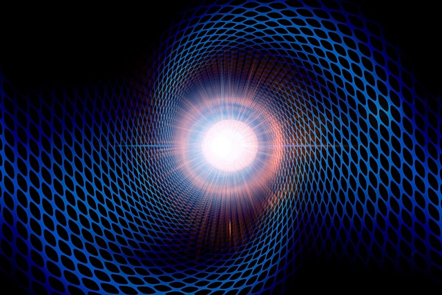

  

::: {.text-end}
> *“To create is not to add. It is to strip away the noise, the fear, the walls.”*  
> — **Professor Alvin**
:::

---

```{python}
#| echo: true
#| code-fold: true
#| code-summary: "Click to see library imports"

import sys
if 'google.colab' in sys.modules:
    # 1. Download qmc.py from GitHub
    !wget -q https://raw.githubusercontent.com/nicdeclic/quantum-molecular-computing/main/qmc.py
    
    # 2. Download requirements.txt from GitHub
    !wget -q https://raw.githubusercontent.com/nicdeclic/quantum-molecular-computing/main/requirements.txt

    # 3. Install dependencies
    !pip install -q -r requirements.txt

sys.path.insert(0, "../../src") # Select root directory
from qmc import * # QMC library

%reload_ext autoreload
%autoreload 2

```

## Junction Resonances

Let us now explore the resonance manifolds of various molecular junctions.

We begin with a simple elementary case: the **linear junction**.

```{python}
#| code-fold: true
#| fig-align: center

# Create Molecule
mol1 = CarbonMolecule("linear junction")

# Add atoms
c1 = mol1.add_atom(x=0, y=0, visible=False)
c2 = mol1.add_atom(x=0.5, y=0.5, visible=True)
c3 = mol1.add_atom(x=1, y=0.0, visible=False)

# Add bonds
b1 = mol1.add_bond(c1, c2, order="single", label="A")
b2 = mol1.add_bond(c2, c3, order="single", label="B")

# Draw with Schemdraw
mol1.draw()

```

This junction exhibits two distinct resonance modes:

```{python}
#| code-fold: true
#| fig-align: center
#| layout-ncol: 2

all_resonances = mol1.resonance()

for i, res_mol in enumerate(all_resonances):
    res_mol.draw() 

```

We can compile these resonance states into a truth table where each row corresponds to one of the possible resonance configurations.

```{python}
#| code-fold: true
#| fig-align: center
#| layout-ncol: 1

CarbonMolecule.resonance_table(all_resonances)

```

As we can observe, the state of $B$ is always the exact inverse of $A$. This yields a truth table functionally identical to a classical **NOT gate**.


You can practice by sketching an arbitrary simple junction and determining its allowed resonance modes. It is a remarkably effective exercise for developing a physical feel for how these molecular networks behave.

Through this exercise, you will quickly encounter the **triangular junction**:

```{python}
#| code-fold: true
#| fig-align: center

# Create Molecule
mol2 = CarbonMolecule("triangular junction")

# Add atoms
c1 = mol2.add_atom(x=0, y=0.75, visible=False)
c2 = mol2.add_atom(x=-0.75, y=-0.75, visible=False)
c3 = mol2.add_atom(x=0.75, y=-0.75, visible=False)
c4 = mol2.add_atom(x=0, y=0.25, visible=True)
c5 = mol2.add_atom(x=-0.25, y=-0.25, visible=True)
c6 = mol2.add_atom(x=0.25, y=-0.25, visible=True)

# Add bonds
b1 = mol2.add_bond(c1, c4, order="single", label="A")
b2 = mol2.add_bond(c2, c5, order="single", label="B")
b3 = mol2.add_bond(c3, c6, order="single", label="C")
b4 = mol2.add_bond(c4, c5, order="single")
b5 = mol2.add_bond(c5, c6, order="single")
b6 = mol2.add_bond(c6, c4, order="single")

# Draw with Schemdraw
mol2.draw()

```

It features four resonance modes:

```{python}
#| code-fold: true
#| fig-align: center
#| layout-ncol: 4

all_resonances = mol2.resonance()

for i, res_mol in enumerate(all_resonances):
    res_mol.draw() 

```

And here is the resulting truth table:

```{python}
#| code-fold: true
#| fig-align: center
#| layout-ncol: 1

CarbonMolecule.resonance_table(all_resonances)

```

Notice that this table directly mirrors the behavior of a **XNOR gate**.


Now let us examine a slightly more intricate topology: the **"H" junction**.

```{python}
#| code-fold: true
#| fig-align: center

# Create Molecule
mol3 = CarbonMolecule('"H" junction')

# Add atoms
c1 = mol3.add_atom(x=0, y=0.5, visible=False)
c2 = mol3.add_atom(x=0, y=-0.5, visible=False)
c3 = mol3.add_atom(x=0.5, y=0, visible=True)
c4 = mol3.add_atom(x=1, y=0, visible=True)
c5 = mol3.add_atom(x=1.5, y=0.5, visible=False)
c6 = mol3.add_atom(x=1.5, y=-0.5, visible=False)

# Add bonds
b1 = mol3.add_bond(c1, c3, order="single", label="A")
b2 = mol3.add_bond(c2, c3, order="single", label="B")
b3 = mol3.add_bond(c5, c4, order="single", label="C")
b4 = mol3.add_bond(c6, c4, order="single", label="D")
b5 = mol3.add_bond(c3, c4, order="single")

# Draw with Schemdraw
mol3.draw()

```

This junction possesses five resonance modes:

```{python}
#| code-fold: true
#| fig-align: center
#| layout-ncol: 3

all_resonances = mol3.resonance()

for i, res_mol in enumerate(all_resonances):
    res_mol.draw() 

```

And here is the resulting table:

```{python}
#| code-fold: true
#| fig-align: center
#| layout-ncol: 1

CarbonMolecule.resonance_table(all_resonances)

```

Note that the table above does not correspond to any standard logic gate. Some row values are missing. So even a combination of classical boolean gates wouldn't be able to represent this logic. The vast majority of molecular topologies behave this way.  

Classical boolean logic provides no native vocabulary to express such non-uniform states. 

Deterministic certainty dissolves here. We are forced to broaden our theoretical horizons into statistics.

---

## Probabilistic Bits (p-bits)

Probabilistic bits provide a robust mathematical framework for encoding and processing information. By applying this formalism to carbon-carbon bonds, we can natively capture the stochastic nature of chemical systems and open up new frontiers in molecular computing.  

Think of a coin toss. Once flipped, the coin can land on tails (state **"0"**) or heads (state **"1"**).  

With a fair coin, there is an equal probability—a 50% chance—of landing on state "0" and a 50% chance of landing on state "1".  

Mathematically, we formulate probabilistic bits using the same transition matrices introduced earlier. The only operational difference lies in the values of the matrix elements.  

* **A fair coin:** :  
```{python}
#| code-fold: true

display_inline("Fair", "=", random.to_katex(show_labels=True))

```

The first element quantifies the probability of observing a **"0"**; the second element quantifies the probability of observing a **"1"**.  

We could also bias the coin so that it carries a one-in-four chance (25%) of landing on "0", and a three-in-four chance (75%) of landing on "1".  

* **A biased coin:** :  
```{python}
#| code-fold: true

biased = TransitionMatrix([
    [0.25, 0.75]
])

display_inline("Biased", "=", biased.to_katex(show_labels=True))

```

The limiting boundary case occurs when there is a 0% chance of being in one state and a 100% chance of being in the other. Under these conditions, deterministic certainty is recovered, and the probabilistic bit collapses back into a classical boolean bit.  

Any continuous probability distribution is physically admissible, provided that two fundamental axioms are satisfied:  
1. Every individual element must lie strictly within the closed interval $[0, 1]$.  
2. The elements along each row must sum to exactly **1** (equivalent to 100%—the total probability space). Consequently, there is no probability leak into unmodeled states (for example, ruling out the pathological edge case where the coin lands balanced on its side).  

And because of the missing row values we must add a third axiom:

3. The elements along a row representing an invalid state must sum to exactly **0** (dead-end).

So for the "H" junction if we define A, B, C as inputs and D as the output, the transition matrix representing this molecular circuit would be:

```{python}
#| code-fold: true

hjunction = TransitionMatrix([
    [1,0],
    [0,0],
    [0,1],
    [1,0],
    [0,1],
    [1,0],
    [0,0],
    [0,0]
])

display_inline("Hjunction", "=", hjunction.to_katex(show_labels=True))

```

---

Finally, consider the **square junction**:

```{python}
#| code-fold: true
#| fig-align: center

# Create Molecule
mol4 = CarbonMolecule("square junction")

# Add atoms
c1 = mol4.add_atom(x=0, y=0.5, visible=False)
c2 = mol4.add_atom(x=0, y=-1, visible=False)
c3 = mol4.add_atom(x=0.5, y=0, visible=True)
c4 = mol4.add_atom(x=1, y=0, visible=True)
c5 = mol4.add_atom(x=1, y=-0.5, visible=True)
c6 = mol4.add_atom(x=0.5, y=-0.5, visible=True)
c7 = mol4.add_atom(x=1.5, y=0.5, visible=False)
c8 = mol4.add_atom(x=1.5, y=-1, visible=False)

# Add bonds
b1 = mol4.add_bond(c1, c3, order="single", label="A")
b2 = mol4.add_bond(c2, c6, order="single", label="B")
b3 = mol4.add_bond(c7, c4, order="single", label="C")
b4 = mol4.add_bond(c8, c5, order="single", label="D")
b5 = mol4.add_bond(c3, c4, order="single")
b6 = mol4.add_bond(c4, c5, order="single")
b7 = mol4.add_bond(c5, c6, order="single")
b8 = mol4.add_bond(c6, c3, order="single")

# Draw with Schemdraw
mol4.draw()

```

It exhibits seven resonance modes in total:

```{python}
#| code-fold: true
#| fig-align: center
#| layout-ncol: 3

all_resonances = mol4.resonance()

for i, res_mol in enumerate(all_resonances):
    res_mol.draw()

```

The resulting table:

```{python}
#| code-fold: true
#| fig-align: center
#| layout-ncol: 1

CarbonMolecule.resonance_table(all_resonances)

```

Here, a fundamentally new situation arises: the first two rows, consisting entirely of zeros, repeat themselves. Consequently, this specific resonance mode carries **twice the statistical weight** of the others. 

---

 

## Protobits

A "poor man’s quantum computer" refers to a probabilistic computer built using p-bits (probabilistic bits) instead of traditional bits or quantum qubits.

But conjugated carbon molecules are inherently quantum.

---

## Common Objections

* **"A molecule featuring a three-membered ring would be energetically unstable due to extreme ring strain."**

* **"Several of these proposed topologies are non-aromatic, meaning their resonance structures are by no means equiprobable."**

* **"Larger molecular networks would suffer from rapid environmental decoherence in any realistic, noisy medium."**

* **"How are the physical inputs and outputs concretely interfaced with the rest of the circuit?"**

---

