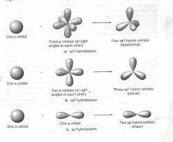
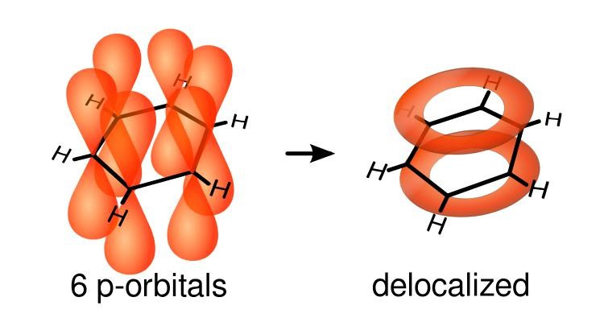
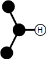
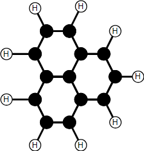
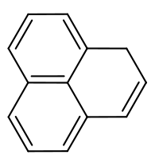

  

::: {.text-end}
> *"An atom has no identity of its own. Only a function within the whole."*  
> — **Professor Alvin**
:::

---

[](https://colab.research.google.com/github/nicdeclic/quantum-molecular-computing/blob/main/posts/quantum-chemistry/index.ipynb)
```{python}
#| echo: true
#| code-fold: true
#| code-summary: "Click to see library imports"

import sys
if 'google.colab' in sys.modules:
    # 1. Download qmc.py from GitHub
    !wget -q https://raw.githubusercontent.com/nicdeclic/quantum-molecular-computing/main/qmc.py
    
    # 2. Download requirements.txt from GitHub
    !wget -q https://raw.githubusercontent.com/nicdeclic/quantum-molecular-computing/main/requirements.txt

    # 3. Install dependencies
    !pip install -q -r requirements.txt

sys.path.insert(0, "../../src") # Select root directory
from qmc import * # QMC library

%reload_ext autoreload
%autoreload 2

```

---

Could it be that the capacity to process and manipulate information is woven into the very fabric of molecules?  

We now turn to explore the untapped potential of atoms and their chemical bonds to create sophisticated computational systems.

---

## Chemical Bonds

The molecules of primary interest here are those with carbon atoms, owing to their fundamental ability to form four covalent bonds. While other elements, such as silicon, share this tetravalent property, carbon will serve as our foundational element throughout this blog due to its central role in organic chemistry.  

Carbon atoms do not dance alone in this molecular choreography; they interact with other key elements, notably hydrogen (which typically forms one bond), oxygen (which forms two), and nitrogen (which forms three). Combined with carbon, these elements constitute the elemental building blocks of a rich and complex chemistry:  

```{python}
#| code-fold: true
#| fig-align: center

with schemdraw.Drawing() as d:
    d.config(fontsize=14)

    # --- Row 1: Single Bond (H - C) ---
    d += elm.Line(lw=2).at((0, 0)).to((2.5, 0))
    # Draw dots AFTER the line so they sit cleanly on top
    d += elm.Dot(radius=0.45).at((0, 0)).color('#1E88E5').fill('#E3F2FD').label('H', loc='center', color='black')
    d += elm.Dot(radius=0.45).at((2.5, 0)).color('#424242').fill('#E0E0E0').label('C', loc='center', color='black')
    d += elm.Label().at((3.6, 0)).label('Hydrogen – Carbon: 1 bond', halign='left', valign='center')

    # --- Row 2: Double Bond (O = C) ---
    d += elm.Line(lw=4.5).at((0, -2)).to((2.5, -2))
    d += elm.Dot(radius=0.45).at((0, -2)).color('#E53935').fill('#FFCDD2').label('O', loc='center', color='black')
    d += elm.Dot(radius=0.45).at((2.5, -2)).color('#424242').fill('#E0E0E0').label('C', loc='center', color='black')
    d += elm.Label().at((3.6, -2)).label('Oxygen – Carbon: 2 bonds', halign='left', valign='center')

    # --- Row 3: Triple Bond (N ≡ C) ---
    d += elm.Line(lw=7.5).at((0, -4)).to((2.5, -4))
    d += elm.Dot(radius=0.45).at((0, -4)).color('#43A047').fill('#C8E6C9').label('N', loc='center', color='black')
    d += elm.Dot(radius=0.45).at((2.5, -4)).color('#424242').fill('#E0E0E0').label('C', loc='center', color='black')
    d += elm.Label().at((3.6, -4)).label('Nitrogen – Carbon: 3 bonds', halign='left', valign='center')
```

Chemical bonds can naturally be harnessed to encode discrete binary states. For instance, a single bond between two carbon atoms can be defined as representing a state **"0"**, whereas a double bond can represent a state **"1"**.  
We will not be using triple bonds here for reasons that will soon become clear. 

---

## Orbitals

Where do these specific bond valencies and spatial bond angles actually originate? The answer lies within the concept of atomic and molecular orbitals.  

An orbital is a region of space around an atomic nucleus where the probability of finding an electron is highest. These regions are governed by mathematical wavefunctions—the direct solutions to the fundamental equations of quantum mechanics.  

These orbitals exhibit varied geometries and scales, classified by sets of quantum numbers. The $s$, $p$, $d$, and $f$ subshells, for instance, possess distinct spatial shapes that directly dictate how atoms bond. The $p$-orbitals, with their characteristic dumbbell-shaped lobes oriented along Cartesian axes, are critically important for the formation of the covalent bonds prevalent in organic and aromatic architectures.  

When atomic orbitals interact, they combine to produce **hybrid orbitals**, which ultimately govern the geometry of molecular structures.  
For carbon:  
* **$sp^3$ hybridization** yields four single bonds symmetrically arranged in a three-dimensional tetrahedron (with $\approx 109.5^\circ$ angles).  
* **$sp^2$ hybridization** yields planar geometries ($\approx 120^\circ$ angles), creating the structural framework for double bonds.  
* **$sp$ hybridization** yields linear geometries ($180^\circ$ angles), establishing triple bonds.  

{height="400px" fig-align="center"} 

### Delocalization in Conjugated Systems

In conjugated and aromatic systems, electrons are free to delocalize across multiple atomic centers:  

Take benzene as the quintessential example: the $\pi$ (pi) electrons that form the alternating double bonds are not strictly bound between adjacent pairs of carbon atoms. Instead, they form a continuous, delocalized electron cloud extending uniformly over the entire hexagonal ring.  

{fig-align="center"}   

This resonance phenomenon is a direct physical manifestation of quantum mechanics. It demonstrates how quantum entities occupy coherent superpositions rather than classical point-like positions.  
To be clear: these are not localized particles mechanically "spinning in circles" around the ring, but rather an integrated, collective electronic state.  

This delocalization is far from a mere theoretical curiosity; it carries profound practical implications. The continuous nature of the $\pi$-cloud dictates the molecule's chemical stability, its electronic band structure, its charge transport capabilities, and its optical response.  

---

## The Initial Spark: Trivalent Carbon Nodes

The computational potential of a carbon atom bonded to three adjacent atoms ($sp^2$ planar center) is particularly intriguing. Such an atom acts naturally as a **branching node** within a molecular graph, where each chemical bond functions as a logical interconnect.

To satisfy carbon's fundamental tetravalence (four total bonds), **exactly one** of these three bonds can be a double bond at any given moment, while the remaining two must be single bonds. Consequently, the local bond configuration at this trivalent node can manifest in three mutually exclusive states:

```{python}
#| code-fold: true
#| fig-align: center
#| layout-ncol: 3
#| fig-cap: 
#|   - "1. Bond $A$ is double; bonds $B$ and $C$ are single."
#|   - "2. Bond $B$ is double; bonds $A$ and $C$ are single."
#|   - "3. Bond $C$ is double; bonds $A$ and $B$ are single."

# Create a conjugated 3-carbon node
mol = CarbonMolecule("TrivalentNode")

# Add 4 atoms (Center node + 3 branches)
c_center = mol.add_atom(x=0, y=0, isotope="C12")
c_top    = mol.add_atom(x=0, y=0.5, isotope="C12", visible=False, label="C1")
c_left   = mol.add_atom(x=-0.435, y=-0.4, isotope="C12", visible=False, label="C2")
c_right  = mol.add_atom(x=0.435, y=-0.4, isotope="C12", visible=False, label="C3")

# Add bonds (one double bond, two single bonds)
b1 = mol.add_bond(c_center, c_top, order="double", label="A")
b2 = mol.add_bond(c_center, c_left, order="single", label="B")
b3 = mol.add_bond(c_center, c_right, order="single", label="C")

# Draw with Schemdraw
mol.draw()

# Second resonance
b1.order = "single"
b2.order = "double"

mol.draw()

# Third resonance
b2.order = "single"
b3.order = "double"

mol.draw()

```

This set of configurations corresponds directly to the resonance structures of the molecular node.

We can express this physical valence constraint through the following Boolean relation:

$$ (A \mathbin{\text{Xor}} B \mathbin{\text{Xor}} C) \mathbin{\text{Xor}} (A \mathbin{\text{And}} B \mathbin{\text{And}} C) = \text{"1"} $$

Or represented as an equivalent logic circuit:

```{python}
#| code-fold: true
#| fig-align: center

with schemdraw.Drawing() as d:
    d.config(fontsize=12, unit=2.5)

    # 1. Gates: 3-input XOR (top) and 3-input AND (bottom)
    # inputs=3 exposes anchors: in1, in2, in3
    xor3 = d.add(logic.Xor(inputs=3).right().at((4, 2)))
    and3 = d.add(logic.And(inputs=3).right().at((4, 0)))

    # 2. Final 2-input XOR combining both branches
    xor_final = d.add(logic.Xor().right().at((6, 1)))
    d.add(elm.Wire('|-').at(xor3.out).to(xor_final.in1))
    d.add(elm.Wire('|-').at(and3.out).to(xor_final.in2))

    # Output line constrained to "1"
    d.add(elm.Line().right(1.5).at(xor_final.out).label('"1"', loc='right'))

    # 3. Clean input bus routing for A, B, C
    # Input A (top pin: in1)
    d.add(elm.Line().left(3).at(xor3.in1).label('A', loc='left'))
    d.add(elm.Dot().at((xor3.in1[0]-0.5,xor3.in1[1])))
    d.add(elm.Wire('|-').at((xor3.in1[0]-0.5,xor3.in1[1])).to(and3.in1))

    # Input B (middle pin: in2)
    d.add(elm.Line().left(3).at(xor3.in2).label('B', loc='left'))
    d.add(elm.Dot().at((xor3.in2[0]-1.0,xor3.in2[1])))
    d.add(elm.Wire('|-').at((xor3.in2[0]-1.0,xor3.in2[1])).to(and3.in2))

    # Input C (bottom pin: in3)
    d.add(elm.Line().left(3).at(xor3.in3).label('C', loc='left'))
    d.add(elm.Dot().at((xor3.in3[0]-1.5,xor3.in3[1])))
    d.add(elm.Wire('|-').at((xor3.in3[0]-1.5,xor3.in3[1])).to(and3.in3))
    
```

Given that combining an **AND** operation with an **XOR** operation provides the functional completeness required to synthesize a universal **NAND** gate, we immediately see that all the necessary mathematical ingredients for universal computation are naturally embedded within the valence rules of a single carbon node.

There is clearly substantial potential here — the challenge now is simply learning how to tame and harness it... 

It was precisely this early, encouraging realization that provided the initial momentum to dive deeper into the exploration of conjugated carbon circuits.

---

## Skeletal Structures

After systematically testing every possible combination, it became clear that only two fundamental types of connections are strictly necessary:  

::: {layout-ncol=2 layout-valign="center"}
{height="150px"}

{height="150px"}
:::

Because the presence of hydrogen atoms can be unambiguously deduced by counting the number of carbon-carbon bonds, we can streamline our drawings by adopting **skeletal structures**.  
  

::: {layout-ncol=2 layout-valign="center"}
{height="400px"}

{height="250px"}
:::

Notice the subtle yet crucial differences compared to standard skeletal notation:  

{height="300px" fig-align="left"} 

The convention of drawing double bonds offset to one specific side of a ring — even when that $\pi$-bond is physically shared across two fused rings — is far too crude and misleading. Particularly when looking for symmetries.  

Dotted carbon atoms should also be drawn. As we move forward, we will be analyzing the resonance manifolds of highly intricate molecular networks. Sometimes the lines get curvy and it isn't clear anymore where the atoms are.

The last thing we need is to bog down our analysis with ambiguous notations. Clarity is paramount.  

---

## Junction Resonances

Let us now explore the resonance manifolds (Kekulé states) of various molecular junctions.

We begin with a simple elementary case: the **linear junction**.

```{python}
#| code-fold: true
#| fig-align: center

# Create Molecule
mol1 = CarbonMolecule("linear junction")

# Add atoms
c1 = mol1.add_atom(x=0, y=0, visible=False)
c2 = mol1.add_atom(x=0.5, y=0.5, visible=True)
c3 = mol1.add_atom(x=1, y=0.0, visible=False)

# Add bonds
b1 = mol1.add_bond(c1, c2, order="single", label="A")
b2 = mol1.add_bond(c2, c3, order="single", label="B")

# Draw with Schemdraw
mol1.draw()

```
Note: in junctions we can see bonds that end without an atom. This simply illustrates that the atom is connected to another one outside the page. Obviously, in our physical reality, a bond can never end in a void.

This junction exhibits two distinct resonance modes:

```{python}
#| code-fold: true
#| fig-align: center
#| layout-ncol: 2

all_resonances = mol1.resonance()

for i, res_mol in enumerate(all_resonances):
    res_mol.draw() 

```

We can compile these resonance states into a truth table where each row corresponds to one of the possible resonance configurations.

```{python}
#| code-fold: true
#| fig-align: center
#| layout-ncol: 1

CarbonMolecule.resonance_table(all_resonances)

```

As we can observe, the state of $B$ is always the exact inverse of $A$. This yields a truth table functionally identical to a classical **NOT gate**.


You can practice by sketching an arbitrary simple junction and determining its allowed resonance modes. It is a remarkably effective exercise for developing a physical feel for how these molecular networks behave.

Through this exercise, you will quickly encounter the **triangular junction**:

```{python}
#| code-fold: true
#| fig-align: center

# Create Molecule
mol2 = CarbonMolecule("triangular junction")

# Add atoms
c1 = mol2.add_atom(x=0, y=0.75, visible=False)
c2 = mol2.add_atom(x=-0.75, y=-0.75, visible=False)
c3 = mol2.add_atom(x=0.75, y=-0.75, visible=False)
c4 = mol2.add_atom(x=0, y=0.25, visible=True)
c5 = mol2.add_atom(x=-0.25, y=-0.25, visible=True)
c6 = mol2.add_atom(x=0.25, y=-0.25, visible=True)

# Add bonds
b1 = mol2.add_bond(c1, c4, order="single", label="A")
b2 = mol2.add_bond(c2, c5, order="single", label="B")
b3 = mol2.add_bond(c3, c6, order="single", label="C")
b4 = mol2.add_bond(c4, c5, order="single")
b5 = mol2.add_bond(c5, c6, order="single")
b6 = mol2.add_bond(c6, c4, order="single")

# Draw with Schemdraw
mol2.draw()

```

It features four resonance modes:

```{python}
#| code-fold: true
#| fig-align: center
#| layout-ncol: 4

all_resonances = mol2.resonance()

for i, res_mol in enumerate(all_resonances):
    res_mol.draw() 

```

And here is the resulting truth table:

```{python}
#| code-fold: true
#| fig-align: center
#| layout-ncol: 1

CarbonMolecule.resonance_table(all_resonances)

```

Notice that this table directly mirrors the behavior of a **XNOR gate**.


Now let us examine a slightly more intricate topology: the **"H" junction**.

```{python}
#| code-fold: true
#| fig-align: center

# Create Molecule
mol3 = CarbonMolecule('"H" junction')

# Add atoms
c1 = mol3.add_atom(x=0, y=0.5, visible=False)
c2 = mol3.add_atom(x=0, y=-0.5, visible=False)
c3 = mol3.add_atom(x=0.5, y=0, visible=True)
c4 = mol3.add_atom(x=1, y=0, visible=True)
c5 = mol3.add_atom(x=1.5, y=0.5, visible=False)
c6 = mol3.add_atom(x=1.5, y=-0.5, visible=False)

# Add bonds
b1 = mol3.add_bond(c1, c3, order="single", label="A", role="input")
b2 = mol3.add_bond(c2, c3, order="single", label="B", role="input")
b3 = mol3.add_bond(c5, c4, order="single", label="C", role="input")
b4 = mol3.add_bond(c6, c4, order="single", label="D", role="output")
b5 = mol3.add_bond(c3, c4, order="single")

# Draw with Schemdraw
mol3.draw()

```

This junction possesses five resonance modes:

```{python}
#| code-fold: true
#| fig-align: center
#| layout-ncol: 3

all_resonances = mol3.resonance()

for i, res_mol in enumerate(all_resonances):
    res_mol.draw() 

```

And here is the resulting table:

```{python}
#| code-fold: true
#| fig-align: center
#| layout-ncol: 1

CarbonMolecule.resonance_table(all_resonances)

```

Note that the table above does not correspond to any standard logic gate. Some row values are missing. So even a combination of classical boolean gates wouldn't be able to represent this logic. The vast majority of molecular topologies behave this way.  

---

## Forbidden Transitions

We need a consistent way to handle impossible or missing input configurations in our transition matrices. We achieve this by setting all elements along the corresponding row to **0** (representing an unreachable or dead-end state).

For the "H" junction above, if we define $A$, $B$, and $C$ as inputs and $D$ as the output, the transition matrix representing this molecular circuit becomes:

```{python}
#| code-fold: true

hjunction = TransitionMatrix.from_resonances(all_resonances)

display_inline("Hjunction", "=", hjunction.to_katex(show_labels=True))

```

Because certain rows sum to less than 1 (zero, in fact), the matrix becomes **sub-stochastic**. This should not be a cause for concern: it is not a defect or a bug in a Markov chain. 

We can compute with such matrices seamlessly. Simply think of an all-zero row as an algebraic placeholder indicating that a given input combination is physically forbidden by the molecule's valency rules.

---

## The Junction Snag

Up to this point, our exploration has yielded two functional primitives: a **NOT gate** (from the linear junction) and a **XNOR gate** (from the triangular junction). 

While promising, this set is insufficient for universal computation. In boolean algebra, $\{ \text{NOT}, \text{XNOR} \}$ generates only affine (linear) functions. To achieve a Turing-complete, universal logic family, we fundamentally require a non-linear primitive: an **AND gate** or an **OR gate**.

Then comes the dramatic plot twist: **neither an AND gate nor an OR gate can be constructed using boundary bonds of junctions alone.**

To see why, consider a standard AND gate and imagine a simple feedback loop: if we tie its output back to one of its inputs, the remaining free input must still be capable of freely accepting either a `"0"` or a `"1"` while remaining topologically consistent. 

```{python}
#| code-fold: true

# Initialize the schematic canvas
with schemdraw.Drawing() as d:
    d.config(fontsize=12, unit=2.5)

    # 1. Place the 2-input AND gate
    and_gate = d.add(logic.And().right())

    # 2. Top Input: Lead wire connected to label "X"
    d.add(
        elm.Line()
        .left(1.5)
        .at(and_gate.in1)
        .label("X", loc="left")
    )

    # 3. Output wire extending to the right
    out_wire = d.add(
        elm.Line()
        .right(1)
        .at(and_gate.out)
    )

    # 4. Feedback loop: wire routing from output back into the bottom input (in2)
    d.add(elm.Line().down(1).at(out_wire.end))
    d.add(elm.Line().left(3.6))
    d.add(elm.Wire("|-").to(and_gate.in2))  # Clean 90-degree landing into input 2

```

Within a conjugated junction, however, this flexibility collapses. The strict local valency constraints (exactly one $\pi$-bond per $sp^2$ carbon) force rigid correlations across the entire network. The boundary bonds cannot fluctuate independently; their states are frozen into rigid, complementary pairs—either locked at `"0"` or locked at `"1"`. The network lacks the internal degree of freedom required to break symmetry.

In other words, imagine a black box with a single carbon bond sticking out (representing the input 'X' to our self-looped AND gate). Whatever molecular topology sits inside that box, it will only ever succeed in clamping that sticking bond to a fixed `"0"` or a fixed `"1"`. **Never both simultaneously.** It cannot act as a truly independent, open-ended variable.

Because we already possess a functional NOT gate, the ability to construct an OR gate would immediately yield an AND gate via **De Morgan's laws**:  

$$\text{AND}(A, B) = \overline{\text{OR}(\overline{A}, \, \overline{B})}$$  

The impossibility of constructing an AND gate therefore seals the fate of the OR gate as well. Neither can exist within these passive junctions, completely blocking our path toward a universal logic family.  

This snag became a major roadblock — the kind of theoretical brick wall that stalls an investigation for months on end. Nature does not yield its computational secrets that easily!  

A junction alone is too rigid, too linear. To break the deadlock, we must look beyond and introduce a new mechanism into the carbon backbone...

---

👉 **Next chapter :**  
**["Quantum Chemistry Part 2"](/posts/quantum-chemistry2/index.html)**