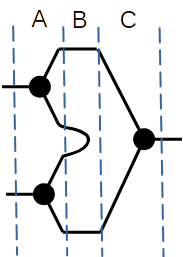

  

::: {.text-end}
> *"Harmony is not uniformity… it is cacophony learning to dance."*  
> — **Professor Alvin**
:::

---

[](https://colab.research.google.com/github/nicdeclic/quantum-molecular-computing/blob/main/posts/quantum-chemistry/index.ipynb)
```{python}
#| echo: true
#| code-fold: true
#| code-summary: "Click to see library imports"

import sys
if 'google.colab' in sys.modules:
    # 1. Download qmc.py from GitHub
    !wget -q https://raw.githubusercontent.com/nicdeclic/quantum-molecular-computing/main/qmc.py
    
    # 2. Download requirements.txt from GitHub
    !wget -q https://raw.githubusercontent.com/nicdeclic/quantum-molecular-computing/main/requirements.txt

    # 3. Install dependencies
    !pip install -q -r requirements.txt

sys.path.insert(0, "../../src") # Select root directory
from qmc import * # QMC library

%reload_ext autoreload
%autoreload 2

```

---

## Solving Molecular Epilepsy

What is needed now is a way to remove the parasitic resonances.  

Based on the observation that, generally, the more complex a conjugated molecule is, the more resonance modes it possesses, it should therefore be possible to simplify the molecule. That is to say, reduce the complexity of the bonds in order to keep only the intended resonance modes.  

---

## Simplifying the Molecule

If we take the "Letter Envelope" structure and connect the two outputs of the NOR gates together, we obtain the 4 intended resonances plus the 2 expected parasitic resonances.  

```{python}
#| code-fold: true
#| fig-align: center
#| layout-ncol: 2

# Create a conjugated carbon molecule
mol = CarbonMolecule("Letter Envelope, NOR gates together")

# Add atoms
c2_1 = mol.add_atom(x=-0.8, y=0.5)
c2_2 = mol.add_atom(x=0.8, y=0.5)
c2_3 = mol.add_atom(x=-0.3, y=0)
c2_4 = mol.add_atom(x=0.3, y=0)
c2_5 = mol.add_atom(x=-0.8, y=-0.5)
c2_6 = mol.add_atom(x=0.8, y=-0.5)

# Add bonds
b2_1 = mol.add_bond(c2_1, c2_2, order="single")
b2_2 = mol.add_bond(c2_1, c2_6, order="single", ctrl1=[-2.0, 0.5], ctrl2=[-0.75, -2.5])
b2_3 = mol.add_bond(c2_2, c2_5, order="single", ctrl1=[2.0, 0.5], ctrl2=[0.75, -2.5])
b2_4 = mol.add_bond(c2_1, c2_3, order="single")
b2_5 = mol.add_bond(c2_2, c2_4, order="single")
b2_6 = mol.add_bond(c2_3, c2_4, order="single")
b2_7 = mol.add_bond(c2_3, c2_5, order="single")
b2_8 = mol.add_bond(c2_4, c2_6, order="single")
b2_9 = mol.add_bond(c2_5, c2_6, order="single")

all_resonances = mol.resonance()

for i, res_mol in enumerate(all_resonances):
    res_mol.draw(margin=0.8) 

```

However, if we remove one of the connections, the molecule settles into a new, stable state without any parasites.   

```{python}
#| code-fold: true
#| fig-align: center
#| layout-ncol: 2

mol.remove_bond(b2_2)

all_resonances = mol.resonance()

for i, res_mol in enumerate(all_resonances):
    res_mol.draw(margin=0.8) 

```

This results in a new structure called the "Barred Eight". It acts as the functional equivalent of an AND logic gate.  

```{python}
#| code-fold: true
#| fig-align: center
#| layout-ncol: 2

#| code-fold: true
#| fig-align: center
#| layout-ncol: 2

# Create a conjugated carbon molecule
mol = CarbonMolecule("Barred Eight")

# Add atoms
c2_1 = mol.add_atom(x=-0.7, y=1.0)
c2_2 = mol.add_atom(x=0.7, y=1.0)
c2_3 = mol.add_atom(x=-0.7, y=0)
c2_4 = mol.add_atom(x=0.7, y=0)
c2_5 = mol.add_atom(x=-0.7, y=-1.0)
c2_6 = mol.add_atom(x=0.7, y=-1.0)

# Add bonds
b2_1 = mol.add_bond(c2_1, c2_2, order="single")
b2_3 = mol.add_bond(c2_2, c2_5, order="single", label="C", label_pos=[0.25, 0.4])
b2_4 = mol.add_bond(c2_1, c2_3, order="single", label="A")
b2_5 = mol.add_bond(c2_2, c2_4, order="single")
b2_6 = mol.add_bond(c2_3, c2_4, order="single")
b2_7 = mol.add_bond(c2_3, c2_5, order="single")
b2_8 = mol.add_bond(c2_4, c2_6, order="single", label="B")
b2_9 = mol.add_bond(c2_5, c2_6, order="single")

all_resonances = mol.resonance()

for i, res_mol in enumerate(all_resonances):
    res_mol.draw() 

```

```{python}
#| code-fold: true
#| fig-align: center
#| layout-ncol: 1

CarbonMolecule.resonance_table(all_resonances)

```

Yet, more complex molecules require far more advanced transformations. It is not always as simple as removing a few bonds.  
Unfortunately, at present, no general algorithm exists to automate this process. It remains an active area of research.  

---

## Quantum Couplers

Another approach is to filter the connections directly, since that is where the parasitic resonances originate.   

Ideally, we would insert an intermediate filter molecule along the interconnect to ensure that both branches always maintain the exact same logical state.  

However, such a purely chemical filter cannot work: because it must itself be open at both ends to connect into the circuit, it will inevitably develop the exact same parasitic resonances. We would simply be reproducing the initial problem.  

To break this loop, we must rely on a different physical mechanism: **quantum and electrostatic induction.**  

When two conjugated bonds are brought physically close to one another without touching, their $\pi$-electron clouds interact across space. Just like electrical induction in classical physics, the alternating oscillation of electrons in one bond exerts an electrostatic and quantum exchange force on the neighbor:  
* If one bond shifts into a double bond ($\pi$-density), its local electric field repels or aligns the electron density of the adjacent bond.  
* The two lines synchronize their states through the vacuum without sharing a single physical atom.  

This wireless, contact-free bridge is what we call a **Quantum Coupler** or **Coupler** in short.  

The coupling strength follows a strict physical scaling:  
1. **Shorter distance = stronger coupling:** As the spatial gap narrows, the interaction strength increases drastically.  
2. **More bond pairs = higher efficiency:** Chaining multiple coupled pairs in parallel reinforces the coherence.  

By keeping the distance short enough and using enough parallel bond pairs, the synchronization efficiency can approach virtually **100%**.  

---

### Typology of Couplers

Several physical geometries can be engineered:  

* **Parallel Coupler:** The simplest design to build. The two branches of the dual-rail interconnect are simply routed parallel and brought into close physical proximity.  

```{python}
#| code-fold: true
#| fig-align: center
#| layout-ncol: 1

# Create a conjugated carbon molecule
mol = CarbonMolecule("Parallel Coupler")

# Add atoms
c1 = mol.add_atom(x=-2.0, y=0.25, visible=False)
c2 = mol.add_atom(x=-1.5, y=0.0)
c3 = mol.add_atom(x=-1.0, y=0.25)
c4 = mol.add_atom(x=-0.5, y=0.0)
c5 = mol.add_atom(x=0.0, y=0.25)
c6 = mol.add_atom(x=0.5, y=0.0)
c7 = mol.add_atom(x=1.0, y=0.25)
c8 = mol.add_atom(x=1.5, y=0.0)
c9 = mol.add_atom(x=2.0, y=0.25, visible=False)

c10 = mol.add_atom(x=-2.0, y=-0.25, visible=False)
c11 = mol.add_atom(x=-1.5, y=-0.5)
c12 = mol.add_atom(x=-1.0, y=-0.25)
c13 = mol.add_atom(x=-0.5, y=-0.5)
c14 = mol.add_atom(x=0.0, y=-0.25)
c15 = mol.add_atom(x=0.5, y=-0.5)
c16 = mol.add_atom(x=1.0, y=-0.25)
c17 = mol.add_atom(x=1.5, y=-0.5)
c18 = mol.add_atom(x=2.0, y=-0.25, visible=False)

# Add bonds
b1 = mol.add_bond(c1, c2, order="single")
b2 = mol.add_bond(c2, c3, order="single")
b3 = mol.add_bond(c3, c4, order="single")
b4 = mol.add_bond(c4, c5, order="single")
b5 = mol.add_bond(c5, c6, order="single")
b6 = mol.add_bond(c6, c7, order="single")
b7 = mol.add_bond(c7, c8, order="single")
b8 = mol.add_bond(c8, c9, order="single")

b9 = mol.add_bond(c10, c11, order="single")
b10 = mol.add_bond(c11, c12, order="single")
b11 = mol.add_bond(c12, c13, order="single")
b12 = mol.add_bond(c13, c14, order="single")
b13 = mol.add_bond(c14, c15, order="single")
b14 = mol.add_bond(c15, c16, order="single")
b15 = mol.add_bond(c16, c17, order="single")
b16 = mol.add_bond(c17, c18, order="single")

coupler1 = mol.add_coupler(b4, b12)
coupler2 = mol.add_coupler(b5, b13)

mol.draw() 

```

The blue dashed line is here to show that there is a coupling between bonds.

* **Series Coupler:** The molecular equivalent of the schematic of an electrical transformer. Two closed conjugated loops are placed side-by-side, transferring logic states purely through mutual resonance induction.  

```{python}
#| code-fold: true
#| fig-align: center
#| layout-ncol: 1

# Create a conjugated carbon molecule
mol = CarbonMolecule("Series Coupler")

# Add atoms
c1 = mol.add_atom(x=-2.0, y=0.5)
c2 = mol.add_atom(x=-1.0, y=0.5)
c3 = mol.add_atom(x=-1.0, y=-0.5)
c4 = mol.add_atom(x=-2.0, y=-0.5)

c5 = mol.add_atom(x=-0.5, y=0.5)
c6 = mol.add_atom(x=0.5, y=0.5)
c7 = mol.add_atom(x=0.5, y=-0.5)
c8 = mol.add_atom(x=-0.5, y=-0.5)

# Add bonds
b1 = mol.add_bond(c1, c2, order="single")
b2 = mol.add_bond(c2, c3, order="single")
b3 = mol.add_bond(c3, c4, order="single")
b4 = mol.add_bond(c4, c1, order="single")

b5 = mol.add_bond(c5, c6, order="single")
b6 = mol.add_bond(c6, c7, order="single")
b7 = mol.add_bond(c7, c8, order="single")
b8 = mol.add_bond(c5, c8, order="single")

coupler = mol.add_coupler(b8, b2)

mol.draw() 

```

* **$\pi$-Stacking Coupler (Face-to-Face):** Instead of lying in the same 2D plane, conjugated rings are stacked directly on top of each other (via aromatic $\pi$-$\pi$ stacking). This vertical configuration is exceptionally powerful for routing signals out of the plane and designing **three-dimensional (3D) molecular circuits**.  

```{python}
#| code-fold: true
#| fig-align: center
#| layout-ncol: 1

# Create a conjugated carbon molecule
mol = CarbonMolecule("Pi-Stacking Coupler")

# Add atoms
c1 = mol.add_atom(x=-0.25, y=1.0)
c2 = mol.add_atom(x=0.25, y=1.0)
c3 = mol.add_atom(x=-1.0, y=0.75, visible=False)
c4 = mol.add_atom(x=-0.6, y=0.75)
c5 = mol.add_atom(x=0.6, y=0.75)
c6 = mol.add_atom(x=1.0, y=0.75, visible=False)
c7 = mol.add_atom(x=-0.25, y=0.5)
c8 = mol.add_atom(x=0.25, y=0.5)

c9 = mol.add_atom(x=-0.25, y=0.0)
c10 = mol.add_atom(x=0.25, y=0.0)
c11 = mol.add_atom(x=-1.0, y=-0.25, visible=False)
c12 = mol.add_atom(x=-0.6, y=-0.25)
c13 = mol.add_atom(x=0.6, y=-0.25)
c14 = mol.add_atom(x=1.0, y=-0.25, visible=False)
c15 = mol.add_atom(x=-0.25, y=-0.5)
c16 = mol.add_atom(x=0.25, y=-0.5)

# Add bonds
b1 = mol.add_bond(c1, c2, order="single")
b2 = mol.add_bond(c3, c4, order="single")
b3 = mol.add_bond(c4, c1, order="single")
b4 = mol.add_bond(c2, c5, order="single")
b5 = mol.add_bond(c5, c6, order="single")
b6 = mol.add_bond(c4, c7, order="single")
b7 = mol.add_bond(c7, c8, order="single")
b8 = mol.add_bond(c8, c5, order="single")

b9 = mol.add_bond(c9, c10, order="single")
b10 = mol.add_bond(c11, c12, order="single")
b11 = mol.add_bond(c12, c9, order="single")
b12 = mol.add_bond(c10, c13, order="single")
b13 = mol.add_bond(c13, c14, order="single")
b14 = mol.add_bond(c12, c15, order="single")
b15 = mol.add_bond(c15, c16, order="single")
b16 = mol.add_bond(c16, c13, order="single")

coupler1 = mol.add_coupler(b1, b9, ctrl1=[-0.1, 0.85], ctrl2=[-0.1, -0.25])
coupler2 = mol.add_coupler(b7, b15, ctrl1=[0.1, 0.75], ctrl2=[0.1, -0.35])

mol.draw()

```

Beyond filtering parasites, couplers solve another major engineering hurdle: **clean fan-out.** They allow a single logic gate to cleanly broadcast its output to multiple gates without any physical wiring tangles or parasitic feedback.  

```{python}
#| code-fold: true
#| fig-align: center
#| layout-ncol: 1

# Create a conjugated carbon molecule
mol = CarbonMolecule("Fan-out")

# Add atoms
c1 = mol.add_atom(x=-0.5, y=1.0)
c2 = mol.add_atom(x=0.5, y=1.0)
c3 = mol.add_atom(x=-1.0, y=0.0)
c4 = mol.add_atom(x=1.0, y=0.0)
c5 = mol.add_atom(x=-0.5, y=-1.0)
c6 = mol.add_atom(x=0.5, y=-1.0)

c7 = mol.add_atom(x=-0.5, y=1.4)
c8 = mol.add_atom(x=0.5, y=1.4)
c9 = mol.add_atom(x=-0.5, y=2.5, visible=False)
c10 = mol.add_atom(x=0.5, y=2.5, visible=False)

c11 = mol.add_atom(x=-1.3, y=-0.2)
c12 = mol.add_atom(x=-0.8, y=-1.2)
c13 = mol.add_atom(x=-2.2, y=-1.0, visible=False)
c14 = mol.add_atom(x=-1.7, y=-2.0, visible=False)

c15 = mol.add_atom(x=1.3, y=-0.2)
c16 = mol.add_atom(x=0.8, y=-1.2)
c17 = mol.add_atom(x=2.2, y=-1.0, visible=False)
c18 = mol.add_atom(x=1.7, y=-2.0, visible=False)

# Add bonds
b1 = mol.add_bond(c1, c2, order="single")
b2 = mol.add_bond(c1, c3, order="single")
b3 = mol.add_bond(c2, c4, order="single")
b4 = mol.add_bond(c4, c6, order="single")
b5 = mol.add_bond(c3, c5, order="single")
b6 = mol.add_bond(c5, c6, order="single")

b7 = mol.add_bond(c7, c8, order="single")
b8 = mol.add_bond(c7, c9, order="single")
b9 = mol.add_bond(c8, c10, order="single")

b10 = mol.add_bond(c11, c12, order="single")
b11 = mol.add_bond(c11, c13, order="single")
b12 = mol.add_bond(c12, c14, order="single")

b13 = mol.add_bond(c15, c16, order="single")
b14 = mol.add_bond(c15, c17, order="single")
b15 = mol.add_bond(c16, c18, order="single")

coupler1 = mol.add_coupler(b1, b7)
coupler2 = mol.add_coupler(b5, b10)
coupler3 = mol.add_coupler(b4, b13)

mol.draw() 

```

---

## Molecular Matrix Form

Up to this point, the method for decoding a molecule’s computational behavior has relied on systematically enumerating all of its individual resonance structures one by one.  

However, there is a much more direct, powerful, and scalable approach: **computing the global transition matrix algebraically.**  

The key strategy is to treat the entire molecule as a directed mathematical graph and decompose it into elementary topological motifs.  

Just as classical electronics relies on wires, transistors, and resistors, the molecular graph calculus is built from a compact alphabet of primitive transition operators :  

(note: in the following primitives schematics, inputs are on the left and outputs are on the right)  

```{python}
#| code-fold: true
#| fig-align: center
#| layout-ncol: 2

mol1 = CarbonMolecule("Identity")
c1_1 = mol1.add_atom(x=-0.5, y=0.0, visible=False)
c1_2 = mol1.add_atom(x=0.5, y=0.0, visible=False)
b1_1 = mol1.add_bond(c1_1, c1_2, order="single")
mol1.draw() 

display_inline("Identity", "=", identity.to_katex(show_labels=True))


mol2 = CarbonMolecule("Negate")
c2_1 = mol2.add_atom(x=-0.5, y=0.0, visible=False)
c2_2 = mol2.add_atom(x=0.0, y=0.5)
c2_3 = mol2.add_atom(x=0.5, y=0.0, visible=False)
b2_1 = mol2.add_bond(c2_1, c2_2, order="single")
b2_2 = mol2.add_bond(c2_2, c2_3, order="single")
mol2.draw() 

display_inline("Negate", "=", negate.to_katex(show_labels=True))


mol3 = CarbonMolecule("Swap")
c3_1 = mol3.add_atom(x=-0.5, y=0.25, visible=False)
c3_2 = mol3.add_atom(x=0.5, y=-0.25, visible=False)
c3_3 = mol3.add_atom(x=-0.5, y=-0.25, visible=False)
c3_4 = mol3.add_atom(x=0.5, y=0.25, visible=False)
b3_1 = mol3.add_bond(c3_1, c3_2, order="single")
b3_2 = mol3.add_bond(c3_3, c3_4, order="single")
mol3.draw() 

display_inline("Swap", "=", swap.to_katex(show_labels=True))


mol4 = CarbonMolecule("Fork")
c4_1 = mol4.add_atom(x=-0.5, y=0.0, visible=False)
c4_2 = mol4.add_atom(x=0.0, y=0.0)
c4_3 = mol4.add_atom(x=0.5, y=0.5, visible=False)
c4_4 = mol4.add_atom(x=0.5, y=-0.5, visible=False)
b4_1 = mol4.add_bond(c4_1, c4_2, order="single")
b4_2 = mol4.add_bond(c4_2, c4_3, order="single")
b4_3 = mol4.add_bond(c4_2, c4_4, order="single")
mol4.draw() 

display_inline("Fork", "=", fork.to_katex(show_labels=True))


mol5 = CarbonMolecule("Merge")
c5_1 = mol5.add_atom(x=-0.5, y=0.5, visible=False)
c5_2 = mol5.add_atom(x=-0.5, y=-0.5, visible=False)
c5_3 = mol5.add_atom(x=0.0, y=0.0)
c5_4 = mol5.add_atom(x=0.5, y=0.0, visible=False)
b5_1 = mol5.add_bond(c5_1, c5_3, order="single")
b5_2 = mol5.add_bond(c5_2, c5_3, order="single")
b5_3 = mol5.add_bond(c5_3, c5_4, order="single")
mol5.draw() 

display_inline("Merge", "=", merge.to_katex(show_labels=True))


mol6 = CarbonMolecule("Open")
c6_1 = mol6.add_atom(x=0.0, y=0.35, visible=False)
c6_2 = mol6.add_atom(x=0.0, y=-0.35, visible=False)
b6_1 = mol6.add_bond(c6_1, c6_2, order="single", ctrl1=[-0.5, 0.5], ctrl2=[-0.5, -0.5])
mol6.draw(margin=0.5)

display_inline("Open", "=", open.to_katex(show_labels=True))


mol7 = CarbonMolecule("Close")
c7_1 = mol7.add_atom(x=0.0, y=0.35, visible=False)
c7_2 = mol7.add_atom(x=0.0, y=-0.35, visible=False)
b7_1 = mol7.add_bond(c7_1, c7_2, order="single", ctrl1=[0.5, 0.5], ctrl2=[0.5, -0.5])
mol7.draw(margin=0.5)

display_inline("Close", "=", close.to_katex(show_labels=True))

```

Notice the geometric symmetries embedded within these primitives:

* **Self-Dual Motifs:** **Identity**, **Negate**, and **Swap** are their own topological duals. Reversing their operational direction leaves their matrix representations strictly invariant.
* **Dual Pairs:** **Fork** and **Merge** form a complementary pair: they represent the exact same trivalent junction, simply with inputs and outputs exchanged. The same directional duality connects **Open** and **Close**.

Mathematically, this backward operation is achieved by transposing the matrix, followed by a row-normalization step to enforce that all accessible states sum strictly to 1, or 0 for forbidden transitions.  

Using standard mathematical notation, transposition is denoted by the superscript $\mathbf{T}$, while row-normalization is enclosed within curly braces $\mathbf{\{ \dots \}}$:  

For example:
$$\text{Fork} = \{\text{Merge}^\mathbf{T}\}$$  

$$\text{Merge} = \{\text{Fork}^\mathbf{T}\}$$  

Using standard linear algebra—the **Kronecker tensor product ($\otimes$)** for parallel components, and the **matrix dot product ($\cdot$)** for sequential cascade — we can analytically synthesize complex circuits.  

For example, the triangular **XNOR junction** can be calculated directly by assembling primitive blocks:  

{fig-align="center"}

```{python}
#| code-fold: true
#| fig-align: center
#| layout-ncol: 1

m = ((fork ^ fork) @ (identity ^ close ^ identity) @ (merge))

display_inline("Xnor", "=", r"\Big\{", "A", r"\cdot", "B", r"\cdot", "C", r"\Big\}")

display_inline(r"\Rightarrow", "Xnor", "=", r"\Big\{", "(", "Fork",  r"\otimes",  "Fork", ")", r"\cdot", "(", "Identity",  r"\otimes", "Close", r"\otimes", "Identity", ")", r"\cdot", "(", "Merge", ")", r"\Big\}")

display_inline(r"\Rightarrow", "Xnor", "=", m.normalize().to_katex(show_labels=True))

```

Carrying out this matrix multiplication yields the exact $4 \times 2$ stochastic truth table we previously derived by hand!  

This algebraic calculus generalizes seamlessly to larger, closed-form systems.  

* **Couplers** can likewise be expressed in matrix form:  

```{python}
#| code-fold: true
#| fig-align: center
#| layout-ncol: 2

display_inline("Coupler", "=", coupler_q.to_katex(show_labels=True))

```

Rather than acting as spatial routing wires, a Coupler acts as a **diagonal projector / filter matrix**—algebraically annihilating incompatible product states across coupled lines and preserving only the symmetric, synchronized subspace.  

---

## Finally Success?

**Yes! This time, the foundation holds.**  

Every essential building block has now been identified: from fundamental carbon junctions and resonance states to dual-rail interconnects, universal NOR logic, and parasitic-filtering couplers. The baseline theory is established, mathematically coherent, and fully functional!  

*“But wait...”* the skeptic might object. *“This is still just theory on paper, isn’t it? Some concepts seem radically counterintuitive. Where is the tangible physical prototype?”*  

First comes the blueprint, then comes the machine.  

Historically, every monumental breakthrough in computing began as quiet derivations on a notepad. Alan Turing did not begin with silicon microchips, and quantum computing existed purely on chalkboards decades before the first qubit was frozen in a lab.  

There are still vital, pioneering concepts waiting to be developed — and that is precisely what the upcoming posts will unpack.  

---

## {width=50px} Speculations & Wild Thoughts

* For the Mathematically Inclined: A Bridge to Monoidal Categories & ZX-Calculus  

The decomposition into Identity, Swap, Fork, and Merge is not an accident: it directly mirrors the **Symmetric Monoidal Categories (SMC)** found in modern graphical frameworks like Bob Coecke’s **ZX-Calculus**.

* **Sequential composition ($\cdot$)** routes resonance across time (matrix dot product).
* **Parallel composition ($\otimes$)** spaces lines across space (Kronecker product).
* **Duality ($\{\cdot\}^\mathbf{T}$)** provides the "cups and caps" for bidirectional, reversible flow.

The radical difference is **ontological**: while the ZX-calculus is an abstract software tool for quantum compilers, our algebra is **physically embodied in real matter**. 

Here, the nodes are real $sp^2$ carbon atoms, the wires are genuine $\pi$-bonds, and computation is executed natively as electrons settle into their ground state.
  
  
* The Taelon Mosaic and Quantum Linguistics  

In Season 1, Episode 13 of the classic sci-fi series *Earth: Final Conflict* (*"The Secret of Strandhill"*), an ancient Taelon artifact is unearthed: a decorative stone mosaic that is revealed to be **a readable language**.  

At first glance, reading a continuous, 2D geometric mosaic like a text sounds like pure Hollywood techno-babble. Yet, it bears a striking resemblance to our molecular calculus: **representing complex physical functions as an interconnected alphabet of topological matrix tiles** (`Identity`, `Fork`, `Merge`, `Coupler`).  

Human spoken and written languages are strictly one-dimensional and chronological: words follow one after another in a linear sequence ($A \to B \to C$). This classical syntax makes it nearly impossible for our languages to naturally articulate quantum properties like simultaneous superposition, non-local entanglement, and bidirectional causality without awkward mathematical jargon.  

What if a language wasn't a 1D string of letters, but a **two-dimensional resonant graph**?  

In such a "molecular language":  
* The geometric arrangement of tiles directly dictates which resonance states are allowed or forbidden.  
* Reading the language is not a sequential decoding process, but filtering the molecule through its boundary connections.  
* A single statement can hold multiple valid meanings simultaneously (superposition) until constrained by adjacent tiles.  

How far could such physical linguistics be pushed in the real world? Could the molecular graph notation be the first prototype of a language capable of natively "speaking" quantum mechanics?  

In any case, huge kudos to the writers—George Carson and Gene Roddenberry—for intuitively envisioning a geometric language long before the rest of us started drawing logic into carbon rings!  
**['"Earth: Final Conflict S01 EP13 "The Secret of Strandhill"'](https://www.youtube.com/watch?v=Ep_VRrbjXyc)**  

---

👉 **Next chapter :**  
**["Towards a Physical Implementation"](/posts/toward-physical/index.html)**