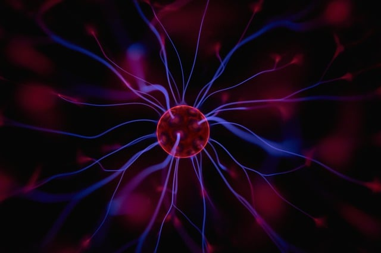
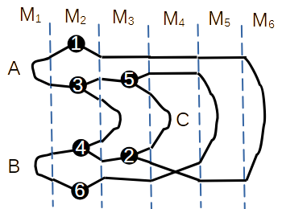
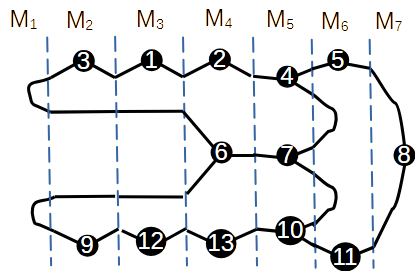

  

::: {.text-end}
> *“Sometimes, constraints are the stars that guide.”*  
> — **Professor Alvin**
:::

---

```{python}
#| echo: true
#| code-fold: true
#| code-summary: "Click to see library imports"

import sys
if 'google.colab' in sys.modules:
    # 1. Download qmc.py from GitHub
    !wget -q https://raw.githubusercontent.com/nicdeclic/quantum-molecular-computing/main/qmc.py
    
    # 2. Download requirements.txt from GitHub
    !wget -q https://raw.githubusercontent.com/nicdeclic/quantum-molecular-computing/main/requirements.txt

    # 3. Install dependencies
    !pip install -q -r requirements.txt

sys.path.insert(0, "../../src") # Select root directory
from qmc import * # QMC library

%reload_ext autoreload
%autoreload 2

```

---

## When Boundary Conditions Break Chemistry

Take any logic gate in its molecular form—for instance, an AND gate implemented via the **Barred Eight**—and inspect its allowed resonance modes closely:  

```{python}
#| code-fold: true
#| fig-align: center
#| layout-ncol: 2

# Create a conjugated carbon molecule
mol = CarbonMolecule("Barred Eight")

# Add atoms
c1 = mol.add_atom(x=-0.7, y=1.0)
c2 = mol.add_atom(x=0.7, y=1.0)
c3 = mol.add_atom(x=-0.7, y=0)
c4 = mol.add_atom(x=0.7, y=0)
c5 = mol.add_atom(x=-0.7, y=-1.0)
c6 = mol.add_atom(x=0.7, y=-1.0)

# Add bonds
b1 = mol.add_bond(c1, c2, order="single")
b3 = mol.add_bond(c2, c5, order="single", label="C", label_pos=[0.25, 0.4])
b4 = mol.add_bond(c1, c3, order="single", label="A")
b5 = mol.add_bond(c2, c4, order="single")
b6 = mol.add_bond(c3, c4, order="single")
b7 = mol.add_bond(c3, c5, order="single")
b8 = mol.add_bond(c4, c6, order="single", label="B")
b9 = mol.add_bond(c5, c6, order="single")

all_resonances = mol.resonance()

for i, res_mol in enumerate(all_resonances):
    res_mol.draw() 

```

Notice a fundamental physical invariance: **every valid resonance structure contains the same total number of single bonds (5) and double bonds (3).**  

This bond-count conservation is a strict thermodynamic prerequisite. It ensures that all accessible resonance configurations reside at the exact same ground-state energy level, allowing the delocalized $\pi$-wavefunction to fluctuate freely across the network.  

Now, what happens if we attempt to compute by posing a question that has **no logically consistent physical answer**?  

Suppose we take our molecular AND gate and clamp its boundary conditions into an impossible contradiction:  
* We hold input $A$ at state **"0"** (single bond).  
* Simultaneously, we force the output $C$ to state **"1"** (double bond).  

In boolean logic, this is a direct contradiction: an AND gate can *never* yield a 1 if an input is 0.  

Even the flexible mathematics of quantum superpositions and transition probabilities completely collapse here. There is simply **no valid resonance mode** in the entire molecular manifold capable of bridging this input to that output.  

What actually happens to the physical carbon molecule if an experimentalist stubbornly forces these incompatible boundary conditions at both terminals?  

Because the carbon skeleton cannot satisfy its strict local octet rule (four covalent bonds per carbon) under these conditions, the network is physically torn out of its neutral ground state: **the molecule is forced into an ionized state.**  

* A carbon vertex is stripped of an electron, creating a high-energy **carbocation** ($C^+$),  
* Or an uncompensated electron accumulates, creating a reactive **carbanion** ($C^-$).  

This is what we define as a **Quantum Exception**.  

Within the paradigm of Conjugated Carbon Computing (CCC), **ions and free radicals are not native computational states—they are physical signatures of unresolved logic.**  

This is Nature's way of saying "I don't know".  

---

### The Hardware Analogy: The Molecular Division by Zero

In classical microprocessors (such as x86 or ARM architectures), attempting an illegal mathematical operation—such as dividing an integer by zero—triggers a hardware interrupt: an **unhandled CPU exception**. The processor halts the pipeline, raises an error flag, and branches to an exception handler.  

Ionization is the molecular hardware equivalent of a **division by zero**:  
* It is a catastrophic violation of boundary constraints.  
* The computational energy diverges.  
* The molecule halts its unitary calculation by paying an enormous electrostatic penalty ($\approx 3\text{--}5\ \text{eV}$).  

Far from being a defect of the theory, this reveals a beautiful physical self-consistency: **the laws of thermodynamics act as the built-in operating system of the molecule**, strictly enforcing logical consistency under penalty of ionization!  

---

## Matrix Formulation: Testing for Molecular Ionization

There is a formal algebraic method to determine whether any arbitrary carbon molecule can exist in a stable, neutral state or whether it is fundamentally forced to become an ion.  

The procedure is universal: we compose the entire molecule into its global transition matrix.  

Depending on the nature of the problem, specific boundary bonds can be clamped to fixed values if desired, or left entirely free to resonate.   

When evaluated as an isolated, closed system with zero free inputs and zero free outputs, the resulting global transition matrix has dimensions $2^0 \times 2^0$, which is simply a **single $1 \times 1$ scalar matrix**:  

Under our standard normalization operator $\{\dots\}$, this scalar collapses into one of two decisive binary outcomes:  

$$\{\mathbf{Molecule}\} = \begin{cases} 
\begin{bmatrix} 1 \end{bmatrix} & \implies \textbf{No Exception} \text{ (Neutral, Non-Ionized Molecule)} \\
\begin{bmatrix} 0 \end{bmatrix} & \implies \textbf{Quantum Exception} \text{ (Forced Ionized / Radical State)}
\end{cases}$$

* **If $\{\mathbf{Molecule}\} = [1]$:** The molecule possesses at least one valid, unfrustrated resonance mode where every carbon satisfies its four covalent bonds. The molecule can exist in a neutral ground state.  
* **If $\{\mathbf{Molecule}\} = [0]$:** It is mathematically impossible for the carbon skeleton to satisfy local valency rules. The molecule has zero valid neutral resonance states and **has no physical choice but to become an ion or a free radical.**  

---

### Demonstrating with Two Elementary Shapes

To visualize this distinction directly, consider two minimal carbon rings evaluated as closed systems:  

#### 1. The Square Ring (4 Carbons):  
A 4-carbon conjugated loop possesses an even number of vertices.  
* It accommodates two distinct resonance states:  
```{python}
#| code-fold: true
#| fig-align: center
#| layout-ncol: 2

# Create a conjugated carbon molecule
mol = CarbonMolecule("Square")

# Add atoms
c1 = mol.add_atom(x=-0.5, y=0.5)
c2 = mol.add_atom(x=0.5, y=0.5)
c3 = mol.add_atom(x=-0.5, y=-0.5)
c4 = mol.add_atom(x=0.5, y=-0.5)

# Add bonds
b1 = mol.add_bond(c1, c2, order="single")
b2 = mol.add_bond(c1, c3, order="single")
b3 = mol.add_bond(c2, c4, order="single")
b4 = mol.add_bond(c3, c4, order="single")

all_resonances = mol.resonance()

for i, res_mol in enumerate(all_resonances):
    res_mol.draw() 

```
* Evaluating its closed transition matrix yields:  
```{python}
#| code-fold: true
#| fig-align: center
#| layout-ncol: 1

square = (open @ (identity ^ identity) @ close).normalize()

display_inline("Square", "=", r"\Big\{", "Open", r"\cdot", "(Identity", r"\otimes", "Identity)", r"\cdot", "Close", r"\Big\}", "=", square)

```

* **Verdict:** No exception. The molecule is stable and neutral.  

#### 2. The Triangular Ring (3 Carbons):  
A 3-carbon loop possesses an odd number of vertices:  
```{python}
#| code-fold: true
#| fig-align: center
#| layout-ncol: 1

# Create a conjugated carbon molecule
mol = CarbonMolecule("Triangular")

# Add atoms
c1 = mol.add_atom(x=0.0, y=0.5, label="+")
c2 = mol.add_atom(x=-0.5, y=-0.5)
c3 = mol.add_atom(x=0.5, y=-0.5)

# Add bonds
b1 = mol.add_bond(c1, c2, order="single")
b2 = mol.add_bond(c2, c3, order="double")
b3 = mol.add_bond(c3, c1, order="single")

mol.draw() 

```
* By fundamental valency rules, it is impossible for three trivalent carbons in a closed ring to each hold exactly one double bond simultaneously without creating an uncompensated charge or an unpaired electron.  
* The internal resonance paths cancel out completely to zero:  
```{python}
#| code-fold: true
#| fig-align: center
#| layout-ncol: 1

triangular = (open @ (identity ^ identity) @ terminate).normalize()

display_inline("Triangular", "=", r"\Big\{", "Open", r"\cdot", "(Identity", r"\otimes", "Identity)", r"\cdot", "Terminate", r"\Big\}", "=", triangular)

```
* **Verdict: Quantum Exception!** The neutral molecule cannot exist. It is forced to become an ion (such as the cyclopropenyl cation $C_3H_3^+$) or a radical.  

---

### Testing the "Barred Eight" (AND Gate)

Let us now apply the scalar matrix contraction to the earlier AND gate structure: the **Barred Eight**.  

#### Case 1: Floating Boundary Conditions
First, we evaluate the circuit with all boundary terminals left floating (free to resonate):   

```{python}
#| code-fold: true
#| fig-align: center
#| layout-ncol: 1

# Create a conjugated carbon molecule
mol = CarbonMolecule("Barred Eight")

# Add atoms
c1 = mol.add_atom(x=-0.7, y=1.0, label="1")
c2 = mol.add_atom(x=0.7, y=1.0, label="2")
c3 = mol.add_atom(x=-0.7, y=0, label="3")
c4 = mol.add_atom(x=0.7, y=0, label="4")
c5 = mol.add_atom(x=-0.7, y=-1.0, label="5")
c6 = mol.add_atom(x=0.7, y=-1.0, label="6")

# Add bonds
b1 = mol.add_bond(c1, c2, order="single")
b3 = mol.add_bond(c2, c5, order="single", label="C", label_pos=[0.25, 0.4])
b4 = mol.add_bond(c1, c3, order="single", label="A")
b5 = mol.add_bond(c2, c4, order="single")
b6 = mol.add_bond(c3, c4, order="single")
b7 = mol.add_bond(c3, c5, order="single")
b8 = mol.add_bond(c4, c6, order="single", label="B")
b9 = mol.add_bond(c5, c6, order="single")

mol.draw(scale=1.5) 

```

Cascading the internal transition operators algebraically yields:  

{height="300px" fig-align="center"}

```{python}
#| code-fold: true
#| fig-align: center
#| layout-ncol: 1

and_floating = ((open ^ open) @ (negate ^ fork ^ fork ^ negate) @ (identity ^ fork ^ close ^ fork ^ identity) @ (identity ^ identity ^ close ^ swap) @ (identity ^ close ^ identity) @ (close)).normalize()

matrix_tex = and_floating.to_katex().data.strip("$ ")

multiline_eq = rf"""\begin{{aligned}}
\text{{And}}_{{\text{{floating}}}} &= \Big\{{ (Open \otimes Open) \cdot \\
&\quad (Negate \otimes Fork \otimes Fork \otimes Negate) \cdot \\
&\quad (Identity \otimes Fork \otimes Close \otimes Fork \otimes Identity) \cdot \\
&\quad (Identity \otimes Identity \otimes Close \otimes Swap) \cdot \\
&\quad (Identity \otimes Close \otimes Identity) \cdot \\
&\quad (Close) \Big\}} = {matrix_tex}
\end{{aligned}}"""

display(Latex(f"$${multiline_eq}$$"))

```

The normalized contraction evaluates strictly to **$[1]$**.  

* **Verdict:** Zero exception. The Barred Eight possesses valid, neutral resonance states and can exist stably without spontaneous ionization.  

#### Case 2: Imposing an Impossible Condition (Clamped Inputs/Outputs)  
Now, let us deliberately force a logical contradiction upon the hardware:  
* Clamping input $A$ to state **"0"** (via $Open_{zero}$),  
* While simultaneously forcing the output $C$ to state **"1"** (via $Close_{one}$).  

```{python}
#| code-fold: true
#| fig-align: center
#| layout-ncol: 1

open_zero = (zero_out ^ zero_out)
close_one = (one_in ^ one_in)

display_inline(r"Open_{zero} = (Zero_{out} \otimes Zero_{out})", "=", open_zero.to_katex(show_labels=True))
display_inline(r"Close_{one} = (One_{in} \otimes One_{in})", "=", close_one.to_katex(show_labels=True))

and_clamped = ((open_zero ^ open) @ (negate ^ fork ^ fork ^ negate) @ (identity ^ fork ^ close ^ fork ^ identity) @ (identity ^ identity ^ close_one ^ swap) @ (identity ^ close ^ identity) @ (close)).normalize()

matrix_tex = and_clamped.to_katex().data.strip("$ ")

multiline_eq = rf"""\begin{{aligned}}
\text{{And}}_{{\text{{clamped}}}} &= \Big\{{ (Open_{{zero}} \otimes Open) \cdot \\
&\quad (Negate \otimes Fork \otimes Fork \otimes Negate) \cdot \\
&\quad (Identity \otimes Fork \otimes Close \otimes Fork \otimes Identity) \cdot \\
&\quad (Identity \otimes Identity \otimes Close_{{one}} \otimes Swap) \cdot \\
&\quad (Identity \otimes Close \otimes Identity) \cdot \\
&\quad (Close) \Big\}} = {matrix_tex}
\end{{aligned}}"""

display(Latex(f"$${multiline_eq}$$"))

```

As theoretically predicted, the contracted scalar collapses strictly to **$[0]$**.  
* **Verdict: Quantum Exception!** The circuit rejects the impossible input/output combination. The molecule cannot satisfy these boundary conditions without forcing an ionized defect.  

---

### A More Complex Molecule

Finally, let us scale up the complexity and test a polycyclic hydrocarbon composed of three fused benzene-like rings: the **Triple Honeycomb**.  

```{python}
#| code-fold: true
#| fig-align: center
#| layout-ncol: 1

# Create a conjugated carbon molecule
mol = CarbonMolecule("Triple Honeycomb")

# Add atoms
c1 = mol.add_atom(x=-0.25, y=1, label="1")
c2 = mol.add_atom(x=0.25, y=1, label="2")
c3 = mol.add_atom(x=-0.5, y=0.5, label="3")
c4 = mol.add_atom(x=0.5, y=0.5, label="4")
c5 = mol.add_atom(x=-0.25, y=0, label="6")
c6 = mol.add_atom(x=0.25, y=0, label="7")
c7 = mol.add_atom(x=-0.5, y=-0.5, label="9")
c8 = mol.add_atom(x=0.5, y=-0.5, label="10")
c9 = mol.add_atom(x=-0.25, y=-1, label="12")
c10 = mol.add_atom(x=0.25, y=-1, label="13")
c11 = mol.add_atom(x=1, y=0.5, label="5")
c12 = mol.add_atom(x=1.25, y=0, label="8")
c13 = mol.add_atom(x=1, y=-0.5, label="11")

# Add bonds
b1 = mol.add_bond(c1, c2, order="single")
b2 = mol.add_bond(c2, c4, order="single")
b3 = mol.add_bond(c1, c3, order="single")
b4 = mol.add_bond(c3, c5, order="single")
b5 = mol.add_bond(c4, c6, order="single")
b6 = mol.add_bond(c5, c6, order="single")
b7 = mol.add_bond(c5, c7, order="single")
b8 = mol.add_bond(c6, c8, order="single")
b9 = mol.add_bond(c7, c9, order="single")
b10 = mol.add_bond(c8, c10, order="single")
b11 = mol.add_bond(c9, c10, order="single")
b12 = mol.add_bond(c4, c11, order="single")
b13 = mol.add_bond(c11, c12, order="single")
b14 = mol.add_bond(c12, c13, order="single")
b15 = mol.add_bond(c13, c8, order="single")

# Draw with Schemdraw
mol.draw(scale=1.5)

```

Let us verify what our matrix calculus predicts when evaluating its closed transition network:  

{height="300px" fig-align="center"}  

It is possible to simplify the equation a little since $M_2 \cdot M_3$ cancel out.

```{python}
#| code-fold: true
#| fig-align: center
#| layout-ncol: 1

triple_honeycomb = ((open**2) @ (negate ^ merge ^ negate) @ (fork**3) @ (negate ^ close**2 ^ negate) @ (terminate)).normalize()

matrix_tex = triple_honeycomb.to_katex().data.strip("$ ")

multiline_eq = rf"""\begin{{aligned}}
\text{{TripleHoneycomb}} &= \Big\{{ (Open^{{\otimes 2}}) \cdot \\
&\quad (Negate \otimes Merge \otimes Negate) \cdot \\
&\quad (Fork^{{\otimes 3}}) \cdot \\
&\quad (Negate \otimes Close^{{\otimes 2}} \otimes Negate) \cdot \\
&\quad (Terminate) \Big\}} = {matrix_tex}
\end{{aligned}}"""

display(Latex(f"$${multiline_eq}$$"))

```

The contraction evaluates strictly to **$[0]$**.  

In organic chemistry, this 13-carbon framework is known as **Phenalene** ($C_{13}H_9$).  

Because it contains an odd number of $sp^2$ carbon atoms (13 vertices), standard valence theory dictates that it cannot accommodate a closed, non-radical Kekulé resonance structure.  

The algebraic framework correctly identifies that **Phenalene is inherently an open-shell system—an intrinsic Quantum Exception.** In nature, this molecule cannot exist in a closed-shell neutral form; it spontaneously stabilizes as a **free radical** or an **ion** (the phenalenyl cation $C_{13}H_9^+$ or anion $C_{13}H_9^-$).  

The matrix algebra reproduces the empirical reality of physical chemistry with absolute precision.  

---

## The Exponential Bottleneck of Classical Simulation

Of course, evaluating this matrix contraction is not magically free.   

As the molecular graph expands, computing the global transition matrix algebraically requires manipulating matrix dimensions that scale exponentially. For large and sprawling molecular networks, this classical matrix algebra rapidly becomes computationally demanding.  

Nevertheless, at the conceptual and formal level, the algebraic criterion remains absolute: if the normalized scalar evaluates to $[0]$, nature raises an unhandled quantum exception—the problem remains physically unresolved unless an external charge is introduced.  

---

## {width=50px} Speculations & Wild Thoughts

* Quantum Exceptions & The Tar Paradox  

During a Quantum Exception, ionization does not occur uniformly or at random.  

Because the molecular topology dictates the energy landscape, the forced ionic defects ($C^+$ carbocations or $C^-$ carbanions) localize at very specific, predictable atomic coordinates across the carbon skeleton. 

Furthermore, if we consider that molecules in a realistic environment are continually subjected to fluctuating external conditions—effectively receiving an ongoing stream of varied computational "problems" to resolve—these localized charge displacements do not merely form static spatial points: **they carve intricate, dynamic signatures across space and time.**

Now, consider what happens when these molecules are granted physical mobility—such as drifting freely within a prebiotic primordial ocean:

These spatiotemporal ionization patterns act as highly specific, electro-topological "fingerprints.". A molecule trapped in an unresolvable state (a "problem molecule," bearing a localized positive exception) will naturally experience long-range Coulombic attraction toward a complementary network (a "higher-level solution molecule," carrying a matching negative exception). 

They do not collide blindly: **they are dynamically steered toward each other by their mutual computational incompatibility.** 

When these complementary topologies dock and react, their opposing charges neutralize each other, resolving the exception and restoring ground-state resonance across the newly merged macro-network. Such highly selective, self-assembling reactions are fundamentally **negentropic** (entropy-reducing)—locally extracting order and structural coherence out of surrounding thermodynamic chaos.

Could this informational mechanism offer a missing chapter to the famous **Miller-Urey experiment** (1952)?

In origin-of-life chemistry, researchers inevitably slam into what astrobiologist Steven Benner coined the **"Tar Paradox" (the Asphalt Wall)**:  
* When organic molecules are exposed to unguided prebiotic energy (spark discharges, UV radiation, heat), organic chemistry does not spontaneously assemble into delicate RNA or proteins.  
* Instead, it rapidly devolves into an intractable, brown-black, biologically dead **sludge—synthetic tar.**  

Perhaps prebiotic chemistry broke through the Tar Paradox not by pure geochemical chance, but through **quantum computational selection**:  

If conjugated carbon networks act as resonant filters, random polymerization is suppressed. Only those molecular architectures whose spatiotemporal exceptions find stable, resonance-closing partners survive the evolutionary sieve.  

Life did not begin by fighting thermodynamics in the dark. Life may have begun as a self-correcting quantum error handler—navigating through the primordial tar by pairing problems with their exact topological solutions.  


* Unresolved Wishes Across the Cosmos  

The implications become even more enchanting when we look beyond direct molecular contact:  

An ionized carbon network trapped in a Quantum Exception does not have to wait for a physical collision to relax. It can shed its excess excitation energy by **emitting a photon**.  

That photon—a solitary quantum of electromagnetic energy—can cross the vast vacuum of space for millions, or even billions, of years, carrying the exact energetic signature of the broken resonance, until it strikes and ionizes another distant molecule across the cosmos.  

Could radiative transfer be Nature’s long-range mechanism for balancing its quantum accounting books—resolving exceptions across astronomical scales?  

Could we venture so far as to imagine that ions, photons, and cosmic radiation are, at their deepest informational level, **a kind of unresolved wish**? An unanswered question launched into the dark, seeking an observer or a complementary structure capable of bringing it to rest.

This poetic realization echoes our ancient childhood folklore: the timeless instinct to **make a wish upon a shooting star**—a fleeting streak of light born from cosmic dust burning as it seeks reconciliation with the Earth.

Now, let your imagination scale up to the cosmos.  

Picture a **black hole** lurking in deep space, quietly drinking in this ancient radiation—gathering billions of years of stray photons, collecting this tapestry of unresolved questions and unanswered wishes emitted by dying stars and stressed matter across the eons.  

Under certain speculative theories of cosmological natural selection, the interior of a black hole does not lead to a dead singularity, but blossoms outward into a Big Bang—**birthing a brand-new baby universe.**  

What if that new cosmos is seeded and shaped by the very information (wishes) it swallowed? A newborn universe endowed with new physical constants, fresh matter, and an entirely blank canvas—ready to embark on a whole new cycle of cosmic adventures!  

Admittedly, this drifts far into the realm of wild, untamed speculation.  

**But after all... what is science without the courage to dream?**  

---

👉 **Next chapter :**  
**["Quantum 2D Bridges"](/posts/2d-bridge/index.html)**