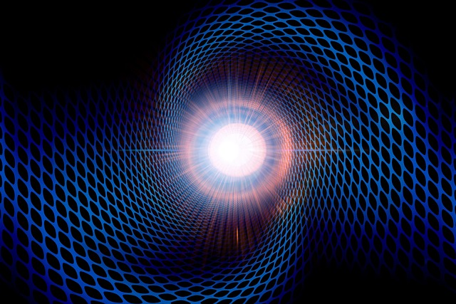

  

::: {.text-end}
> *"Sometimes, unlearning is the highest form of wisdom."*  
> — **Professor Alvin**
:::

---

[](https://colab.research.google.com/github/nicdeclic/quantum-molecular-computing/blob/main/posts/quantum-chemistry/index.ipynb)
```{python}
#| echo: true
#| code-fold: true
#| code-summary: "Click to see library imports"

import sys
if 'google.colab' in sys.modules:
    # 1. Download qmc.py from GitHub
    !wget -q https://raw.githubusercontent.com/nicdeclic/quantum-molecular-computing/main/qmc.py
    
    # 2. Download requirements.txt from GitHub
    !wget -q https://raw.githubusercontent.com/nicdeclic/quantum-molecular-computing/main/requirements.txt

    # 3. Install dependencies
    !pip install -q -r requirements.txt

sys.path.insert(0, "../../src") # Select root directory
from qmc import * # QMC library

%reload_ext autoreload
%autoreload 2

```

---

::: {.callout-note appearance="simple" icon=false}
### 📝 A Quick Note on Mathematical Notation
Because this specific post directly investigates the mapping between standard quantum computing and the CCC molecular model, you will occasionally encounter standard **Dirac bra-ket notation** ($|0\rangle, |1\rangle, |\psi\rangle$) alongside complex unitary matrices.  

This is done to provide a clear, unambiguous bridge for readers familiar with conventional quantum mechanics, making the mathematical translation into the protobit framework as transparent as possible.  
:::

## Representing a Qubit with Protobits  

On the surface, qubits and protobits appear fundamentally incompatible:  

* **Qubits** are described by state vectors with negative and complex probability amplitudes ($\mathbb{C}^2$). This complex phase allows wavefunctions to interfere constructively or destructively (adding or subtracting amplitudes).  
* **Protobits**, operating within stochastic transition matrices, are defined purely over real, non-negative probabilities ($p \in [0, 1]$), with no native complex phase.  

Yet, we have already proven that the molecular gates achieve universal computation. Any mathematical operation—including complex arithmetic and phase rotations—can be synthesized algebraically.  

All that is required now is the optimal geometric mapping.  

### Deconstructing the Bloch Sphere  

Geometrically, a single qubit lives on the continuous surface of a three-dimensional unit sphere: the **Bloch Sphere**.   

To reconstruct the full expressive richness of a spherical state space using only positive-probability protobits, linear algebra dictates that we need a minimum of **three independent dimensions**.  

To completely define the state of a qubit without invoking imaginary numbers in the underlying hardware, we decompose the state across **three distinct functional protobits**:  

1. **The Presence Protobit ($A_2$):**    
   Encodes the vertical projection (along the $Z$-axis), determining whether the measurement collapses toward $|0\rangle$ or $|1\rangle$.  
2. **The Imaginary Phase Protobit ($A_1$):**    
   Governs circular phase along the $Y$-axis, encoding the imaginary depth of the quantum state ($+1$ or $+i$).  
3. **The Sign Phase Protobit ($A_0$):**    
   Governs real interference along the $X$-axis, determining whether wave amplitudes add constructively ($+1$) or destructively ($-1$).  

---

### The 8 Extremal Basis States  

When these three protobits are combined through the Kronecker product, they span an 8-dimensional configuration space ($2^3 = 8$).   

These 8 discrete basis states map directly to the **8 vertices of a state cube**, perfectly capturing the cardinal projections along with their fundamental discrete phase orientations ($\pm 1, \pm i$):  

$$\text{``000''} \longrightarrow \begin{bmatrix} 1 \\ 0 \end{bmatrix} \longrightarrow |0\rangle$$  

$$\text{``001''} \longrightarrow \begin{bmatrix} -1 \\ 0 \end{bmatrix} \longrightarrow -|0\rangle$$  

$$\text{``010''} \longrightarrow \begin{bmatrix} i \\ 0 \end{bmatrix} \longrightarrow i|0\rangle$$  

$$\text{``011''} \longrightarrow \begin{bmatrix} -i \\ 0 \end{bmatrix} \longrightarrow -i|0\rangle$$  

$$\text{``100''} \longrightarrow \begin{bmatrix} 0 \\ 1 \end{bmatrix} \longrightarrow |1\rangle$$  

$$\text{``101''} \longrightarrow \begin{bmatrix} 0 \\ -1 \end{bmatrix} \longrightarrow -|1\rangle$$  

$$\text{``110''} \longrightarrow \begin{bmatrix} 0 \\ i \end{bmatrix} \longrightarrow i|1\rangle$$  

$$\text{``111''} \longrightarrow \begin{bmatrix} 0 \\ -i \end{bmatrix} \longrightarrow -i|1\rangle$$  

By taking convex linear combinations (superpositions) across these 8 positive protobit states, we can reconstruct **any arbitrary point** $(\theta, \phi)$ on the Bloch sphere.  

The mystery of complex quantum phases dissolves into real, positive geometry. Three simple carbon bonds are all that nature needs to house a complete quantum qubit.   

---

## Mapping a Continuous Qubit into a 3-Protobit State Vector

How do we take an arbitrary, continuous quantum qubit state $|\psi\rangle$ defined over complex numbers and convert it into our discrete, strictly non-negative $1 \times 8$ protobit transition matrix?  

A general qubit state is written in Dirac notation as:  

$$|\psi\rangle = c_0 |0\rangle + c_1 |1\rangle = \begin{bmatrix} c_0 \\ c_1 \end{bmatrix}$$  

where $c_0, c_1 \in \mathbb{C}$ are complex probability amplitudes.  

We can expand each complex coefficient into its real and imaginary parts:  

$$c_0 = \text{Re}(c_0) + i \, \text{Im}(c_0)$$
$$c_1 = \text{Re}(c_1) + i \, \text{Im}(c_1)$$   

This gives us **4 real numbers**: $\text{Re}(c_0), \, \text{Im}(c_0), \, \text{Re}(c_1), \, \text{Im}(c_1)$.  

However, these real numbers can be negative, whereas our protobit transition matrices require strictly **non-negative probabilities** ($p \ge 0$).   

To eliminate negative numbers without losing any phase information, we decompose every real value $x$ into its **positive component** ($x^+$) and **negative component** ($x^-$):  

$$x = x^+ - x^- \quad \text{where} \quad x^+ = \max(x, 0), \quad x^- = \max(-x, 0)$$  

Notice that $x^+$ and $x^-$ are **both non-negative ($\ge 0$)**, and at least one of them is always zero!  

Applying this split to our 4 real parameters yields exactly **8 non-negative values** ($p_0$ through $p_7$):  

$$p_0 = \max({Re}(c_0), 0)$$
$$p_1 = \max({-Re}(c_0), 0)$$
$$p_2 = \max({Im}(c_0), 0)$$
$$p_3 = \max({-Im}(c_0), 0)$$
$$p_4 = \max({Re}(c_1), 0)$$
$$p_5 = \max({-Re}(c_1), 0)$$
$$p_6 = \max({Im}(c_1), 0)$$
$$p_7 = \max({-Im}(c_1), 0)$$

To satisfy the conservation of probability, where all row elements must sum to $1.0$, we compute the $L_1$-norm scalar:  

$$S = \sum_{k=0}^{7} p_k$$  

Finally, we normalize each component:  

$$\mathbf{P} = \frac{1}{S} \begin{bmatrix} p_0 & p_1 & p_2 & p_3 & p_4 & p_5 & p_6 & p_7 \end{bmatrix}$$  

The resulting $1 \times 8$ row vector $\mathbf{P}$ is a valid, normalized, non-negative probability distribution over our 3 protobits.  

Not a single bit of information, amplitude, or complex phase from the original qubit is lost. It has simply been unpacked into an 8-channel stochastic representation!  

---

## Quantum Logic Gates as Cube Rotations

Implementing the continuous rotation of a quantum logic gate might appear daunting at first glance. In our discrete framework, however, the problem simplifies drastically: **all we need to specify is where the 8 vertices of our state cube map to.**  

Think of tracking an airplane flying across a pitch-black night sky:  

Inside the cockpit, the pilot relies on continuous gyroscopes and altitude instruments. But an observer standing on the ground below cannot see the fuselage of the plane at all. All they can see are the plane's exterior navigation lights:  
* A **red light** on the left wingtip,  
* A **green light** on the right wingtip,  
* A **white beacon** on the tail / belly.  

Even though the observer only tracks three discrete points of light, they can unambiguously deduce the airplane’s full three-dimensional spatial orientation.   

If the observer initially sees the red light on the left, the green light on the right, and the white beacon underneath—and a moment later observes the red light on the right, the green light on the left, and the white beacon on top—they know with absolute mathematical certainty that the aircraft has executed a **$180^\circ$ roll**.  

We treat quantum logic gates in precisely the same way:  

We do not need to model an intractable, continuous spherical rotation across the entire continuum of the Bloch sphere. We simply track the permutation of our **8 discrete basis vertices**.    

By tracking how these extremal "navigation lights" permute across our protobit coordinates, the global unitary transformation naturally takes care of itself.  

---

## Elementary Single-Qubit Gates

The standard Pauli gates—**$X$, $Y$, and $Z$**, along with the phase gate **$S$**—are classified as "simple" in our framework for two structural reasons:  
1. They operate strictly on a **single logical qubit** (one 3-protobit channel in, one 3-protobit channel out).  
2. Every vertex of our 8-state cube maps cleanly and deterministically onto **another exact vertex of the cube**. There is no splitting of amplitudes or fractional dispersion across vertices.  

Consequently, in this discrete representation, implementing a quantum gate reduces fundamentally to implementing a **truth table permutation**.  

**Keep in mind that while these circuits are structurally composed of boolean logic components, they operate as quantum transition operators capable of manipulating protobit states.** We established their mathematical foundation earlier in ["A Refresher on Boolean Logic"](/posts/boolean-logic/index.html) and ["Boolean Gates Extensions"](/posts/quantum-boolean/index.html) using transition matrix formalism.  

---

### The X Gate (Pauli-X / Bit-Flip)

The $X$ operator swaps the basis states $|0\rangle \leftrightarrow |1\rangle$. It corresponds to a $\pi$ ($180^\circ$) rotation around the $X$-axis of the Bloch sphere:  

$$X = |1\rangle\langle 0| + |0\rangle\langle 1| = \begin{bmatrix} 0 & 1 \\ 1 & 0 \end{bmatrix}$$

* **Truth Table**   
$$
\begin{array}{|c|c|}
\hline
\mathbf{Input\ (Protobits\ \rightarrow\ Qubit)} & \mathbf{Output\ (Protobits\ \rightarrow\ Qubit)} \\
\hline
\text{``000''} \longrightarrow \begin{bmatrix} 1 \\ 0 \end{bmatrix} & \text{``100''} \longrightarrow \begin{bmatrix} 0 \\ 1 \end{bmatrix} \\
\hline
\text{``001''} \longrightarrow \begin{bmatrix} -1 \\ 0 \end{bmatrix} & \text{``101''} \longrightarrow \begin{bmatrix} 0 \\ -1 \end{bmatrix} \\
\hline
\text{``010''} \longrightarrow \begin{bmatrix} i \\ 0 \end{bmatrix} & \text{``110''} \longrightarrow \begin{bmatrix} 0 \\ i \end{bmatrix} \\
\hline
\text{``011''} \longrightarrow \begin{bmatrix} -i \\ 0 \end{bmatrix} & \text{``111''} \longrightarrow \begin{bmatrix} 0 \\ -i \end{bmatrix} \\
\hline
\text{``100''} \longrightarrow \begin{bmatrix} 0 \\ 1 \end{bmatrix} & \text{``000''} \longrightarrow \begin{bmatrix} 1 \\ 0 \end{bmatrix} \\
\hline
\text{``101''} \longrightarrow \begin{bmatrix} 0 \\ -1 \end{bmatrix} & \text{``001''} \longrightarrow \begin{bmatrix} -1 \\ 0 \end{bmatrix} \\
\hline
\text{``110''} \longrightarrow \begin{bmatrix} 0 \\ i \end{bmatrix} & \text{``010''} \longrightarrow \begin{bmatrix} i \\ 0 \end{bmatrix} \\
\hline
\text{``111''} \longrightarrow \begin{bmatrix} 0 \\ -i \end{bmatrix} & \text{``011''} \longrightarrow \begin{bmatrix} -i \\ 0 \end{bmatrix} \\
\hline
\end{array}
$$

* **Logic Schematic**  
```{python}
#| code-fold: true
#| fig-align: center
#| layout-ncol: 1

# Initialize canvas for the Pauli-X logic circuit
with schemdraw.Drawing() as d:
    d.config(fontsize=12, unit=2.5)

    # ==========================================
    # 1. Line A2 (MSB: Presence bit) -> Passes through a NOT gate
    # ==========================================
    # Input wire
    in_a2 = d.add(elm.Line().right(1.2).label("$A_2$", loc="left"))
    
    # NOT Gate (inverter)
    not_gate = d.add(logic.Not().right().at(in_a2.end))
    
    # Output wire
    d.add(elm.Line().right(1.2).at(not_gate.out).label("$B_2$", loc="right"))

    # ==========================================
    # 2. Line A1 (Imaginary Phase bit) -> Straight wire (Identity)
    # ==========================================
    y_a1 = in_a2.start[1] - 1.5
    d.add(
        elm.Line()
        .right(3.8)
        .at((in_a2.start[0], y_a1))
        .label("$A_1$", loc="left")
        .label("$B_1$", loc="right")
    )

    # ==========================================
    # 3. Line A0 (LSB: Sign Phase bit) -> Straight wire (Identity)
    # ==========================================
    y_a0 = in_a2.start[1] - 3.0
    d.add(
        elm.Line()
        .right(3.8)
        .at((in_a2.start[0], y_a0))
        .label("$A_0$", loc="left")
        .label("$B_0$", loc="right")
    )

```

* **Molecular Equivalent**  
```{python}
#| code-fold: true
#| fig-align: center
#| layout-ncol: 1

# Create a conjugated carbon circuit
mol = CarbonMolecule("X gate")

# Add atoms
c1 = mol.add_atom(x=0.0, y=1.0)
c2 = mol.add_atom(x=-1.0, y=1.0)
c3 = mol.add_atom(x=1.0, y=1.0)
c4 = mol.add_atom(x=-1.0, y=0.4)
c5 = mol.add_atom(x=1.0, y=0.4)
c6 = mol.add_atom(x=0.0, y=0.4)

c7 = mol.add_atom(x=-1.0, y=-0.2)
c8 = mol.add_atom(x=1.0, y=-0.2)
c9 = mol.add_atom(x=-1.0, y=-0.8)
c10 = mol.add_atom(x=1.0, y=-0.8)

c11 = mol.add_atom(x=-1.0, y=-1.4)
c12 = mol.add_atom(x=1.0, y=-1.4)
c13 = mol.add_atom(x=-1.0, y=-2.0)
c14 = mol.add_atom(x=1.0, y=-2.0)


# Add bonds
b1 = mol.add_bond(c1, c2, order="single")
b2 = mol.add_bond(c1, c3, order="single")
b3 = mol.add_bond(c2, c4, order="single", label="$A2$")
b4 = mol.add_bond(c3, c5, order="single", label="$B2$")
b5 = mol.add_bond(c4, c6, order="single")
b6 = mol.add_bond(c5, c6, order="single")

b7 = mol.add_bond(c7, c8, order="single")
b8 = mol.add_bond(c7, c9, order="single", label="$A1$")
b9 = mol.add_bond(c8, c10, order="single", label="$B1$")
b10 = mol.add_bond(c9, c10, order="single")

b11 = mol.add_bond(c11, c12, order="single")
b12 = mol.add_bond(c11, c13, order="single", label="$A0$")
b13 = mol.add_bond(c12, c14, order="single", label="$B0$")
b14 = mol.add_bond(c13, c14, order="single")

mol.draw() 

```

* **Molecular Protobits Matrix**  

```{python}
#| code-fold: true
#| fig-align: center
#| layout-ncol: 1

display_inline(r"X_{proto}", "=", x_proto.to_katex(show_labels=True))

```

---

### The Y Gate (Pauli-Y / Bit-and-Phase-Flip)

The $Y$ operator flips the bit and simultaneously introduces an imaginary phase shift. It corresponds to a $\pi$ ($180^\circ$) rotation around the $Y$-axis of the Bloch sphere:  

$$Y = -i |1\rangle\langle 0| + i |0\rangle\langle 1| = \begin{bmatrix} 0 & -i \\ i & 0 \end{bmatrix}$$

* **Truth Table**  
$$
\begin{array}{|c|c|}
\hline
\mathbf{Input\ (Protobits\ \rightarrow\ Qubit)} & \mathbf{Output\ (Protobits\ \rightarrow\ Qubit)} \\
\hline
\text{``000''} \longrightarrow \begin{bmatrix} 1 \\ 0 \end{bmatrix} & \text{``110''} \longrightarrow \begin{bmatrix} 0 \\ i \end{bmatrix} \\
\hline
\text{``001''} \longrightarrow \begin{bmatrix} -1 \\ 0 \end{bmatrix} & \text{``111''} \longrightarrow \begin{bmatrix} 0 \\ -i \end{bmatrix} \\
\hline
\text{``010''} \longrightarrow \begin{bmatrix} i \\ 0 \end{bmatrix} & \text{``101''} \longrightarrow \begin{bmatrix} 0 \\ -1 \end{bmatrix} \\
\hline
\text{``011''} \longrightarrow \begin{bmatrix} -i \\ 0 \end{bmatrix} & \text{``100''} \longrightarrow \begin{bmatrix} 0 \\ 1 \end{bmatrix} \\
\hline
\text{``100''} \longrightarrow \begin{bmatrix} 0 \\ 1 \end{bmatrix} & \text{``011''} \longrightarrow \begin{bmatrix} -i \\ 0 \end{bmatrix} \\
\hline
\text{``101''} \longrightarrow \begin{bmatrix} 0 \\ -1 \end{bmatrix} & \text{``010''} \longrightarrow \begin{bmatrix} i \\ 0 \end{bmatrix} \\
\hline
\text{``110''} \longrightarrow \begin{bmatrix} 0 \\ i \end{bmatrix} & \text{``000''} \longrightarrow \begin{bmatrix} 1 \\ 0 \end{bmatrix} \\
\hline
\text{``111''} \longrightarrow \begin{bmatrix} 0 \\ -i \end{bmatrix} & \text{``001''} \longrightarrow \begin{bmatrix} -1 \\ 0 \end{bmatrix} \\
\hline
\end{array}
$$

* **Logic Schematic**  
```{python}
#| code-fold: true
#| fig-align: center
#| layout-ncol: 1

with schemdraw.Drawing() as d:
    d.config(fontsize=12, unit=2.5)

    # ==========================================
    # 1. Inputs
    # ==========================================
    in_a2 = d.add(elm.Line().right(1.5).label("$A_2$", loc="left"))
    in_a1 = d.add(elm.Line().right(1.0).at((in_a2.start[0], in_a2.start[1] - 1.8)).label("$A_1$", loc="left"))
    in_a0 = d.add(elm.Line().right(0.5).at((in_a2.start[0], in_a2.start[1] - 3.4)).label("$A_0$", loc="left"))

    # ==========================================
    # 2. Connection for XOR on A0
    # ==========================================
    # Tapping points on A2 and A1
    d.add(elm.Dot().at(in_a2.end))
    d.add(elm.Dot().at(in_a1.end))

    # NOT gates on A2 and A1
    not_a2 = d.add(logic.Not().right().at(in_a2.end))
    not_a1 = d.add(logic.Not().right().at(in_a1.end))

    # A2' and A1' outputs
    d.add(elm.Line().right(2.2).at(not_a2.out).label("$B_2$", loc="right"))
    d.add(elm.Line().right(2.2).at(not_a1.out).label("$B_1$", loc="right"))

    # ==========================================
    # 3. 3-input XOR gate for A0'
    # ==========================================
    # XOR gate position at the bottom
    xor_gate = d.add(
        logic.Xor(inputs=3)
        .right()
        .at((in_a0.end[0] + 1.8, in_a0.end[1]+(1/3)))
    )

    # Connection from A2 to XOR.in1 (top)
    d.add(elm.Wire("|-").at(in_a2.end).to(xor_gate.in1))

    # Connection from A1 to XOR.in2 (middle)
    d.add(elm.Wire("|-").at(in_a1.end).to(xor_gate.in2))

    # Connection from A0 to XOR.in3 (bottom)
    d.add(elm.Wire("|-").at(in_a0.end).to(xor_gate.in3))

    # A0' Output
    d.add(elm.Line().right(1.5).at(xor_gate.out).label("$B_0$", loc="right"))

```

* **Molecular Equivalent**  
```{python}
#| code-fold: true
#| fig-align: center
#| layout-ncol: 1

# Create a conjugated carbon circuit
mol = CarbonMolecule("Y gate")

# Add atoms
c1 = mol.add_atom(x=-0.3, y=2.0)
c2 = mol.add_atom(x=0.3, y=2.0)
c3 = mol.add_atom(x=-0.75, y=1.5)
c4 = mol.add_atom(x=0.75, y=1.5)
c5 = mol.add_atom(x=-0.3, y=1.0)
c6 = mol.add_atom(x=0.3, y=1.0)
c7 = mol.add_atom(x=-0.75, y=0.5)
c8 = mol.add_atom(x=0.75, y=0.5)
c9 = mol.add_atom(x=-0.75, y=0.0)
c10 = mol.add_atom(x=0.75, y=0.0)
c11 = mol.add_atom(x=-0.3, y=-0.5)
c12 = mol.add_atom(x=0.3, y=-0.5)
c13 = mol.add_atom(x=-0.75, y=-1.0)
c14 = mol.add_atom(x=0.75, y=-1.0)
c15 = mol.add_atom(x=-0.3, y=-1.5)
c16 = mol.add_atom(x=0.3, y=-1.5)

# Add bonds
b1 = mol.add_bond(c1, c2, order="single", label="$B2$")
b2 = mol.add_bond(c1, c3, order="single", label="$A2$")
b3 = mol.add_bond(c2, c4, order="single")
b4 = mol.add_bond(c3, c5, order="single")
b5 = mol.add_bond(c4, c6, order="single")
b6 = mol.add_bond(c5, c6, order="single", label="$A0$")
b7 = mol.add_bond(c3, c7, order="single")
b8 = mol.add_bond(c4, c8, order="single")
b9 = mol.add_bond(c5, c7, order="single")
b10 = mol.add_bond(c6, c8, order="single")
b11 = mol.add_bond(c7, c9, order="single")
b12 = mol.add_bond(c8, c10, order="single")
b13 = mol.add_bond(c9, c11, order="single")
b14 = mol.add_bond(c10, c12, order="single")
b15 = mol.add_bond(c11, c12, order="single", label="$B0$")
b16 = mol.add_bond(c11, c13, order="single")
b17 = mol.add_bond(c12, c14, order="single")
b18 = mol.add_bond(c9, c13, order="single")
b19 = mol.add_bond(c10, c14, order="single")
b19 = mol.add_bond(c13, c15, order="single", label="$A1$")
b19 = mol.add_bond(c14, c16, order="single")
b19 = mol.add_bond(c15, c16, order="single", label="$B1$")

mol.draw() 

```

Here are the 8 resonance states that prove this molecule is indeed equivalent to the truth table:

```{python}
#| code-fold: true
#| fig-align: center
#| layout-ncol: 2

all_resonances = mol.resonance()

for i, res_mol in enumerate(all_resonances):
    res_mol.draw() 

```

* **Molecular Protobits Matrix**
```{python}
#| code-fold: true
#| fig-align: center
#| layout-ncol: 1

display_inline(r"Y_{proto}", "=", y_proto.to_katex(show_labels=True))

```

---

### The Z Gate (Pauli-Z / Phase-Flip)

The $Z$ operator leaves $|0\rangle$ unchanged and flips the phase of $|1\rangle$ by multiplying it by $-1$. It corresponds to a $\pi$ ($180^\circ$) rotation around the $Z$-axis of the Bloch sphere:  

$$Z = |0\rangle\langle 0| - |1\rangle\langle 1| = \begin{bmatrix} 1 & 0 \\ 0 & -1 \end{bmatrix}$$

* **Truth Table** 
$$
\begin{array}{|c|c|}
\hline
\mathbf{Input\ (Protobits\ \rightarrow\ Qubit)} & \mathbf{Output\ (Protobits\ \rightarrow\ Qubit)} \\
\hline
\text{``000''} \longrightarrow \begin{bmatrix} 1 \\ 0 \end{bmatrix} & \text{``000''} \longrightarrow \begin{bmatrix} 1 \\ 0 \end{bmatrix} \\
\hline
\text{``001''} \longrightarrow \begin{bmatrix} -1 \\ 0 \end{bmatrix} & \text{``001''} \longrightarrow \begin{bmatrix} -1 \\ 0 \end{bmatrix} \\
\hline
\text{``010''} \longrightarrow \begin{bmatrix} i \\ 0 \end{bmatrix} & \text{``010''} \longrightarrow \begin{bmatrix} i \\ 0 \end{bmatrix} \\
\hline
\text{``011''} \longrightarrow \begin{bmatrix} -i \\ 0 \end{bmatrix} & \text{``011''} \longrightarrow \begin{bmatrix} -i \\ 0 \end{bmatrix} \\
\hline
\text{``100''} \longrightarrow \begin{bmatrix} 0 \\ 1 \end{bmatrix} & \text{``101''} \longrightarrow \begin{bmatrix} 0 \\ -1 \end{bmatrix} \\
\hline
\text{``101''} \longrightarrow \begin{bmatrix} 0 \\ -1 \end{bmatrix} & \text{``100''} \longrightarrow \begin{bmatrix} 0 \\ 1 \end{bmatrix} \\
\hline
\text{``110''} \longrightarrow \begin{bmatrix} 0 \\ i \end{bmatrix} & \text{``111''} \longrightarrow \begin{bmatrix} 0 \\ -i \end{bmatrix} \\
\hline
\text{``111''} \longrightarrow \begin{bmatrix} 0 \\ -i \end{bmatrix} & \text{``110''} \longrightarrow \begin{bmatrix} 0 \\ i \end{bmatrix} \\
\hline
\end{array}
$$
* **Logic Schematic**  
```{python}
#| code-fold: true
#| fig-align: center
#| layout-ncol: 1

# Initialize canvas for the Pauli-Z logic circuit
with schemdraw.Drawing() as d:
    d.config(fontsize=12, unit=2.5)

    # 1. Line A2 (MSB) -> Straight wire with a branch tap going down to the XOR
    line_a2 = d.add(elm.Line().right(4.5).label("$A_2$", loc="left").label("$B_2$", loc="right"))
    
    # 2. Line A1 (Middle) -> Pure straight wire (Identity)
    y_a1 = line_a2.start[1] - 1.5
    d.add(
        elm.Line()
        .right(4.5)
        .at((line_a2.start[0], y_a1))
        .label("$A_1$", loc="left")
        .label("$B_1$", loc="right")
    )

    # 3. Line A0 (LSB) -> Passes through a XOR gate controlled by A2
    y_a0 = line_a2.start[1] - 3.0
    
    # Place the XOR gate on line A0
    xor_gate = d.add(logic.Xor().right().at((line_a2.start[0] + 2.0, y_a0 + 0.25)))
    
    # Lead wire from Input A0 to XOR bottom input (in2)
    d.add(elm.Wire("-").at((line_a2.start[0] , y_a0)).to(xor_gate.in2).label("$A_0$", loc="left"))
    
    # Output wire from XOR to A0'
    d.add(elm.Line().at(xor_gate.out).to((line_a2.end[0], y_a0 + 0.25)).label("$B_0$", loc="right"))

    # 4. Control wire from Line A2 down into XOR top input (in1)
    tap_x = line_a2.start[0] + 1.2
    d.add(elm.Dot().at((tap_x, line_a2.start[1]))) # Branch junction on A2
    d.add(elm.Line().down(2.5).at((tap_x, line_a2.start[1])))
    d.add(elm.Wire("|-").to(xor_gate.in1))

```

* **Molecular Equivalent**  
```{python}
#| code-fold: true
#| fig-align: center
#| layout-ncol: 1

# Create a conjugated carbon circuit
mol = CarbonMolecule("Z gate")

# Add atoms
c1 = mol.add_atom(x=-0.5, y=2.0)
c2 = mol.add_atom(x=0.5, y=2.0)
c3 = mol.add_atom(x=-1.0, y=1.5)
c4 = mol.add_atom(x=1.0, y=1.5)
c5 = mol.add_atom(x=-0.5, y=1.0)
c6 = mol.add_atom(x=0.5, y=1.0)
c7 = mol.add_atom(x=-1.0, y=0.5)
c8 = mol.add_atom(x=1.0, y=0.5)
c9 = mol.add_atom(x=-1.0, y=0.0)
c10 = mol.add_atom(x=1.0, y=0.0)
c11 = mol.add_atom(x=-1.0, y=-0.5)
c12 = mol.add_atom(x=1.0, y=-0.5)

# Add bonds
b1 = mol.add_bond(c1, c2, order="single")
b2 = mol.add_bond(c1, c3, order="single", label="$A2$")
b3 = mol.add_bond(c2, c4, order="single", label="$B2$")
b4 = mol.add_bond(c3, c5, order="single")
b5 = mol.add_bond(c4, c6, order="single")
b6 = mol.add_bond(c5, c6, order="single", label="$B0$")
b7 = mol.add_bond(c3, c7, order="single")
b8 = mol.add_bond(c4, c8, order="single")
b9 = mol.add_bond(c7, c5, order="single")
b10 = mol.add_bond(c8, c6, order="single")
b11 = mol.add_bond(c7, c8, order="single", label="$A0$")
b12 = mol.add_bond(c9, c10, order="single")
b13 = mol.add_bond(c10, c12, order="single", label="$B1$")
b14 = mol.add_bond(c12, c11, order="single")
b15 = mol.add_bond(c11, c9, order="single", label="$A1$")

mol.draw() 

```

* **Molecular Protobits Matrix**
```{python}
#| code-fold: true
#| fig-align: center
#| layout-ncol: 1

display_inline(r"Z_{proto}", "=", z_proto.to_katex(show_labels=True))

```

---

### The S Gate (Phase Gate / $\pi/2$ Rotation)

The $S$ gate leaves $|0\rangle$ unchanged and introduces a $\pi/2$ ($90^\circ$) phase rotation on $|1\rangle$, multiplying it by $i$. It corresponds to a quarter-turn rotation around the $Z$-axis of the Bloch sphere:  

$$S = |0\rangle\langle 0| + i |1\rangle\langle 1| = \begin{bmatrix} 1 & 0 \\ 0 & i \end{bmatrix}$$

* **Truth Table**  
$$
\begin{array}{|c|c|}
\hline
\mathbf{Input\ (Protobits\ \rightarrow\ Qubit)} & \mathbf{Output\ (Protobits\ \rightarrow\ Qubit)} \\
\hline
\text{``000''} \longrightarrow \begin{bmatrix} 1 \\ 0 \end{bmatrix} & \text{``000''} \longrightarrow \begin{bmatrix} 1 \\ 0 \end{bmatrix} \\
\hline
\text{``001''} \longrightarrow \begin{bmatrix} -1 \\ 0 \end{bmatrix} & \text{``001''} \longrightarrow \begin{bmatrix} -1 \\ 0 \end{bmatrix} \\
\hline
\text{``010''} \longrightarrow \begin{bmatrix} i \\ 0 \end{bmatrix} & \text{``010''} \longrightarrow \begin{bmatrix} i \\ 0 \end{bmatrix} \\
\hline
\text{``011''} \longrightarrow \begin{bmatrix} -i \\ 0 \end{bmatrix} & \text{``011''} \longrightarrow \begin{bmatrix} -i \\ 0 \end{bmatrix} \\
\hline
\text{``100''} \longrightarrow \begin{bmatrix} 0 \\ 1 \end{bmatrix} & \text{``110''} \longrightarrow \begin{bmatrix} 0 \\ i \end{bmatrix} \\
\hline
\text{``101''} \longrightarrow \begin{bmatrix} 0 \\ -1 \end{bmatrix} & \text{``111''} \longrightarrow \begin{bmatrix} 0 \\ -i \end{bmatrix} \\
\hline
\text{``110''} \longrightarrow \begin{bmatrix} 0 \\ i \end{bmatrix} & \text{``101''} \longrightarrow \begin{bmatrix} 0 \\ -1 \end{bmatrix} \\
\hline
\text{``111''} \longrightarrow \begin{bmatrix} 0 \\ -i \end{bmatrix} & \text{``100''} \longrightarrow \begin{bmatrix} 0 \\ 1 \end{bmatrix} \\
\hline
\end{array}
$$

* **Logic Schematic**  
```{python}
#| code-fold: true
#| fig-align: center
#| layout-ncol: 1

with schemdraw.Drawing() as d:
    d.config(fontsize=12, unit=2.5)

    # Vertical coordinates of the 3 lines
    y2, y1, y0 = 4.0, 2.0, 0.0
    x_in = 0.0

    # ==========================================
    # 1. Logic gates
    # ==========================================
    # AND gate for (A2 AND A1)
    and_gate = d.add(logic.And().right().at((3.0, 1.0)))

    # XOR gate for A1' = A1 XOR A2
    xor_a1 = d.add(logic.Xor().right().at((6.0, y1)))

    # XOR gate for A0' = A0 XOR (A2 AND A1)
    xor_a0 = d.add(logic.Xor().right().at((6.0, y0 + 0.25)))

    # ==========================================
    # 2. Line A2 (MSB) wiring -> Pure identity to A2'
    # ==========================================
    d.add(elm.Line().right(8.0).at((x_in, y2)).label("$A_2$", loc="left").label("$B_2$", loc="right"))
    
    # Branch-off points on line A2
    d.add(elm.Dot().at((1.5, y2)))
    d.add(elm.Wire("|-").at((1.5, y2)).to(and_gate.in1))
    
    d.add(elm.Dot().at((4.5, y2)))
    d.add(elm.Wire("|-").at((4.5, y2)).to(xor_a1.in1))

    # ==========================================
    # 3. Line A1 Wiring
    # ==========================================
    d.add(elm.Line().right(1.8).at((x_in, y1)).label("$A_1$", loc="left"))
    d.add(elm.Dot().at((1.8, y1)))
    
    # Branching to the AND gate
    d.add(elm.Wire("|-").at((1.8, y1)).to(and_gate.in2))
    
    # Main lead to the XOR gate of A1
    d.add(elm.Wire("-|").at((1.8, y1)).to(xor_a1.in2))
    
    # A1' Output
    d.add(elm.Line().right(1.5).at(xor_a1.out).label("$B_1$", loc="right"))

    # ==========================================
    # 4. Line A0 (LSB) Wiring
    # ==========================================
    # Input A0 to the bottom input of xor_a0
    d.add(elm.Line().at((x_in, y0)).to(xor_a0.in2).label("$A_0$", loc="left"))

    # Output from the AND gate to the top input of xor_a0
    d.add(elm.Wire("-|").at(and_gate.out).to(xor_a0.in1))

    # A0' Output
    d.add(elm.Line().right(1.5).at(xor_a0.out).label("$B_0$", loc="right"))

```

* **Molecular Equivalent**  
```{python}
#| code-fold: true
#| fig-align: center
#| layout-ncol: 1

# Create a conjugated carbon circuit
mol = CarbonMolecule("S gate")

# Add atoms
c1 = mol.add_atom(x=-1.0, y=1.0)
c2 = mol.add_atom(x=-0.5, y=1.0)
c3 = mol.add_atom(x=0.0, y=1.0)
c4 = mol.add_atom(x=0.5, y=1.0)
c5 = mol.add_atom(x=1.0, y=1.0)
c6 = mol.add_atom(x=-1.5, y=0.75)
c7 = mol.add_atom(x=-1.7, y=0.25)
c8 = mol.add_atom(x=-0.95, y=0.0)
c9 = mol.add_atom(x=-0.35, y=0.0)
c10 = mol.add_atom(x=0.6, y=0.35)
c11 = mol.add_atom(x=1.0, y=0.5)
c12 = mol.add_atom(x=1.5, y=0.5)
c13 = mol.add_atom(x=-1.3, y=0.0)
c14 = mol.add_atom(x=0.1, y=0.0)
c15 = mol.add_atom(x=0.6, y=-0.35)
c16 = mol.add_atom(x=-1.7, y=-0.25)
c17 = mol.add_atom(x=1.0, y=-0.5)
c18 = mol.add_atom(x=1.5, y=-0.5)
c19 = mol.add_atom(x=-1.5, y=-0.75)
c20 = mol.add_atom(x=-1.0, y=-1.0)
c21 = mol.add_atom(x=0.5, y=-1.0)
c22 = mol.add_atom(x=1.0, y=-1.0)

# Add bonds
b1 = mol.add_bond(c1, c2, order="single")
b2 = mol.add_bond(c1, c6, order="single", label="$A2$")
b3 = mol.add_bond(c2, c3, order="single", label="$B2$")
b4 = mol.add_bond(c3, c4, order="single")
b5 = mol.add_bond(c4, c5, order="single")
b6 = mol.add_bond(c4, c14, order="single")
b7 = mol.add_bond(c5, c11, order="single")
b8 = mol.add_bond(c5, c12, order="single")
b9 = mol.add_bond(c6, c7, order="single")
b10 = mol.add_bond(c7, c13, order="single")
b11 = mol.add_bond(c7, c16, order="single")
b12 = mol.add_bond(c8, c9, order="single", label="$B1$")
b13 = mol.add_bond(c8, c13, order="single")
b14 = mol.add_bond(c9, c14, order="single")
b15 = mol.add_bond(c10, c11, order="single")
b16 = mol.add_bond(c10, c15, order="single", label="$B0$")
b17 = mol.add_bond(c11, c12, order="single")
b18 = mol.add_bond(c12, c18, order="single", label="$A0$")
b19 = mol.add_bond(c13, c16, order="single")
b20 = mol.add_bond(c14, c21, order="single")
b21 = mol.add_bond(c15, c17, order="single")
b22 = mol.add_bond(c16, c19, order="single")
b23 = mol.add_bond(c17, c18, order="single")
b24 = mol.add_bond(c17, c22, order="single")
b25 = mol.add_bond(c18, c22, order="single")
b26 = mol.add_bond(c19, c20, order="single", label="$A1$")
b27 = mol.add_bond(c20, c21, order="single")
b28 = mol.add_bond(c21, c22, order="single")

mol.draw(scale=1) 

```

And here are the 8 resonance states that prove this molecule is indeed equivalent to the truth table:

```{python}
#| code-fold: true
#| fig-align: center
#| layout-ncol: 2

all_resonances = mol.resonance()

for i, res_mol in enumerate(all_resonances):
    res_mol.draw() 

```

* **Molecular Protobits Matrix**
```{python}
#| code-fold: true
#| fig-align: center
#| layout-ncol: 1

display_inline(r"S_{proto}", "=", s_proto.to_katex(show_labels=True))

```

---

{}

## Portes logiques superposées

Hadamard

T

---

## Portes logiques avec plus d'une entrée

Swap

Cnot

### Portes logiques contrôlées

Cz

Toffoli (Ccnot)

### Portes classiques avec une porte Toffoli

---

## Rotations de base

$R_x(\pi)$

$R_y(\pi)$

$R_z(\pi)$

## Phase

$Ph(\pi)$

$Ph(\frac{\pi}{2})$

---

## Fraction de rotation

---

## Portes logiques racines carrés

---

## Circuits de mesure

### Échantillonage

### Recuit Simulé

---

## Exemples classiques

Retour de phase quantique.

Transformations de fourrier quantique.

---

## {width=50px} Speculations & Wild Thoughts

* Quarks of Light: Modeling the Photon as a Protobit Triplet  

If a standard quantum qubit can be faithfully mapped onto a 3-protobit manifold, could the fundamental gauge bosons of the universe—starting with the photon—themselves be composite topologies of three protobits?  

Just as particle physics once viewed hadrons as elementary until they revealed their internal quark triplets, the polarization states, helicity, and phase of light (traditionally mapped onto the Poincaré sphere) might simply be the macroscopic shadow projected by an internal, geometric resonance cavity.  

What if a photon is not an infinitely small, point-like excitation of a continuous field, but an autonomous, self-closing topological loop of three coupled protobits traversing spacetime?  

A prime candidate for this internal resonance cavity is the **truncated tetrahedron** topology, owing to its exact, self-reinforcing manifold of **8 stable resonance modes**.  

```{python}
#| code-fold: true
#| fig-align: center
#| layout-ncol: 2

# Create a conjugated carbon molecule
mol = CarbonMolecule("Truncated Tetrahedron")

# Add atoms
c1 = mol.add_atom(x=-0.25, y=1.0)
c2 = mol.add_atom(x=0.25, y=1.0)
c3 = mol.add_atom(x=0.0, y=0.6)
c4 = mol.add_atom(x=0.0, y=0.2)
c5 = mol.add_atom(x=-0.2, y=-0.25)
c6 = mol.add_atom(x=0.2, y=-0.25)
c7 = mol.add_atom(x=-0.55, y=-0.6)
c8 = mol.add_atom(x=0.55, y=-0.6)
c9 = mol.add_atom(x=-1.2, y=-0.7)
c10 = mol.add_atom(x=1.2, y=-0.7)
c11 = mol.add_atom(x=-0.65, y=-1.0)
c12 = mol.add_atom(x=0.65, y=-1.0)

# Add bonds
b1 = mol.add_bond(c1, c2, order="single")
b2 = mol.add_bond(c2, c3, order="single")
b3 = mol.add_bond(c3, c1, order="single")

b4 = mol.add_bond(c4, c6, order="single")
b5 = mol.add_bond(c6, c5, order="single")
b6 = mol.add_bond(c5, c4, order="single")

b7 = mol.add_bond(c9, c7, order="single")
b8 = mol.add_bond(c7, c11, order="single")
b9 = mol.add_bond(c11, c9, order="single")

b10 = mol.add_bond(c8, c10, order="single")
b11 = mol.add_bond(c10, c12, order="single")
b12 = mol.add_bond(c12, c8, order="single")

b13 = mol.add_bond(c1, c9, order="single", label="A0")
b14 = mol.add_bond(c2, c10, order="single", label="A1")
b15 = mol.add_bond(c11, c12, order="single", label="A2")

b16 = mol.add_bond(c3, c4, order="single")
b17 = mol.add_bond(c6, c8, order="single")
b18 = mol.add_bond(c5, c7, order="single")

all_resonances = mol.resonance()

for i, res_mol in enumerate(all_resonances):
    res_mol.draw() 

```

You have almost certainly seen this exact geometric shape before: **it is the official logo of this website.**  

The true *CCC* signature—our molecular, geometric way of encoding a spark of light!  

* The Universe as a Clifford Algebra of Protobits

Decomposing a qubit reveals a profound mathematical bridge: **it takes $(m + n)$ protobits to span the $2^{m+n}$ multivector space of a Geometric Clifford Algebra $\mathcal{C}\ell(m, n)$.**  

The hierarchy of information unfolds naturally:  
* **$\mathcal{C}\ell(0, 0)$ (1 protobit, 2 states):** The boundary case—a classical or probabilistic boolean bit ($[1 \quad 0]$ or $[0 \quad 1]$).  
* **$\mathcal{C}\ell(0, 2) \cong \mathbb{H}$ lifted into $\mathcal{C}\ell(3, 0)$ (3 protobits, 8 states):** While a standard qubit lives in the 4-dimensional quaternionic algebra $\mathcal{C}\ell(0, 2)$, encoding its signs and phases into non-negative probabilities requires 3 protobits. Its 8 basis states map directly to the **graded elements of 3D space**: 1 scalar, 3 vectors ($X, Y, Z$), 3 bivector planes, and 1 pseudoscalar ($i$).  

This invites a wild cosmological conjecture: **what if physical dimensionality simply reflects the number of entangled protobits?**    
Under this lens, 4D Minkowski spacetime ($\mathcal{C}\ell(1, 3)$) requires 4 protobits ($2^4 = 16$ states, the Dirac algebra), while Grand Unified models ($\mathcal{C}\ell(6)$ or $\mathcal{C}\ell(8)$) demand just 6 to 8 entangled bonds.    

Continuous complex numbers and ethereal wavefunctions are merely emergent illusions. Reality does not compute with abstract qubits in unphysical Hilbert spaces—**it weaves the grammar of $\mathcal{C}\ell(m, n)$ through the physical resonance of Protobits.**  

* Parallels with the I Ching  

Historians of science often recall that Gottfried Wilhelm Leibniz saw the ancient Chinese **I Ching** (*Book of Changes*) as the earliest historical precursor to binary algebra.  

Yet, when viewed through the lens of **Conjugated Carbon Computing (CCC)**, the structural parallels become even more striking, almost eerie:  

* **Stochastic Sampling:** Both systems rely on stochastic processes (throwing yarrow stalks or tossing coins) to collapse possibilities into an observed state—mirroring quantum measurement and statistical p-bit relaxation.  
* **Trigrams as Protobit Triplets:** The fundamental building blocks of the I Ching are **Trigrams** (groups of 3 broken or unbroken lines, yielding $2^3 = 8$ states). This is the exact dimensional cardinality required by our protobit triplets ($A_2, A_1, A_0$) to span the 8 basis states of a complete quantum qubit. The 64 Hexagrams ($2^6$) naturally map to a 2-qubit interacting register!  
* **Turtle Shells & Carbon Geometry:** Historically, ancient divination was performed by heating tortoise plastrons until they cracked into distinct patterns. Visually and geometrically, the natural hexagonal tiling of a turtle shell bears an uncanny resemblance to the fused aromatic rings and polygonal lattices of our molecular carbon logic gates.  
* **The King Wen Sequence:** When mapped as a discrete state transition matrix, the traditional King Wen permutation order exhibits the algebraic properties of a **unitary, reversible 2-input / 2-output Universal quantum gate**.  

I will certainly not claim that ancient diviners possessed an explicit formulation of quantum mechanics; there is zero historical evidence for such an assertion.  

However, it is deeply fascinating to realize that our modern concepts of superposition, dual-rail binary states, and molecular resonance would have felt astonishingly familiar to their worldview.  

Perhaps when humans search for the fundamental patterns of change in nature, all roads eventually lead back to the same underlying geometric syntax.  

---

👉 **Next chapter :**  
**["Quantum Exceptions"](/posts/quantum-exceptions/index.html)**