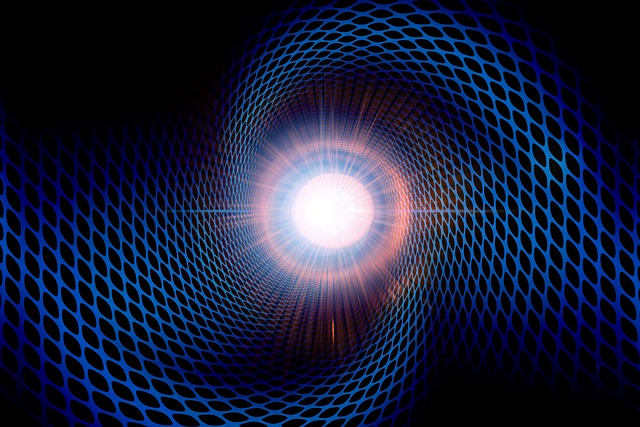

  

---


{}

---

[](https://colab.research.google.com/github/nicdeclic/quantum-molecular-computing/blob/main/posts/quantum-chemistry/index.ipynb)
```{python}
#| echo: true
#| code-fold: true
#| code-summary: "Click to see library imports"

import sys
if 'google.colab' in sys.modules:
    # 1. Download qmc.py from GitHub
    !wget -q https://raw.githubusercontent.com/nicdeclic/quantum-molecular-computing/main/qmc.py
    
    # 2. Download requirements.txt from GitHub
    !wget -q https://raw.githubusercontent.com/nicdeclic/quantum-molecular-computing/main/requirements.txt

    # 3. Install dependencies
    !pip install -q -r requirements.txt

sys.path.insert(0, "../../src") # Select root directory
from qmc import * # QMC library

%reload_ext autoreload
%autoreload 2

```

---

## Superposed Quantum Gates

The Pauli gates ($X, Y, Z$) and the phase gate ($S$) were straightforward because every vertex of our 8-state cube mapped cleanly and deterministically onto another single vertex.  

Gates like the **Hadamard gate ($H$)** and the **$T$ gate ($\pi/8$ rotation)**, however, are fundamentally more complex. Geometrically, they rotate the state to points that lie *between* the vertices—on the faces or edges of the Bloch sphere. They cannot be implemented by a simple one-to-one permutation of discrete vertices.  

---

### The Hadamard Gate

The Hadamard gate is the quintessential quantum superposition operator. In the standard Dirac computational basis, it maps basis states into equal linear combinations:  

$$H = \frac{1}{\sqrt{2}} \begin{bmatrix} 1 & 1 \\ 1 & -1 \end{bmatrix}$$  

$$\begin{aligned}
H |0\rangle &= \frac{1}{\sqrt{2}} \left(|0\rangle + |1\rangle\right) = |+\rangle \\
H |1\rangle &= \frac{1}{\sqrt{2}} \left(|0\rangle - |1\rangle\right) = |-\rangle
\end{aligned}$$

Notice a remarkable mathematical symmetry: the Hadamard matrix can be decomposed exactly as the normalized sum of the **$X$** and **$Z$** Pauli operators:  

$$H = \frac{1}{\sqrt{2}} (X + Z)$$  

This identity provides our architectural blueprint!  

We can synthesize the Hadamard transformation by:  
1. Routing our input protobit triplet $(A_2, A_1, A_0)$ into **both the $X$ circuit and the $Z$ circuit in parallel**.  
2. Superposing the output channel selection using a **fair-coin random source** to balance the branches with equal  probability weights.  

By leveraging physical resonance and stochastic mixing, the discrete geometry of protobits natively recreates the continuous superposition of the Hadamard transform.  

* **Truth Table**   
$$
\begin{array}{|c|c|}
\hline
\mathbf{Input\ (Protobits\ \rightarrow\ Qubit)} & \mathbf{Output\ (Normalized\ Protobits\ \rightarrow\ Qubit)} \\
\hline
\text{``000''} \longrightarrow \begin{bmatrix} 1 \\ 0 \end{bmatrix} & \left\{ \text{``000''} + \text{``100''} \right\} \longrightarrow \frac{1}{\sqrt{2}} \begin{bmatrix} 1 \\ 1 \end{bmatrix} \\
\hline
\text{``001''} \longrightarrow \begin{bmatrix} -1 \\ 0 \end{bmatrix} & \left\{ \text{``001''} + \text{``101''} \right\} \longrightarrow \frac{1}{\sqrt{2}} \begin{bmatrix} -1 \\ -1 \end{bmatrix} \\
\hline
\text{``010''} \longrightarrow \begin{bmatrix} i \\ 0 \end{bmatrix} & \left\{ \text{``010''} + \text{``110''} \right\} \longrightarrow \frac{1}{\sqrt{2}} \begin{bmatrix} i \\ i \end{bmatrix} \\
\hline
\text{``011''} \longrightarrow \begin{bmatrix} -i \\ 0 \end{bmatrix} & \left\{ \text{``011''} + \text{``111''} \right\} \longrightarrow \frac{1}{\sqrt{2}} \begin{bmatrix} -i \\ -i \end{bmatrix} \\
\hline
\text{``100''} \longrightarrow \begin{bmatrix} 0 \\ 1 \end{bmatrix} & \left\{ \text{``000''} + \text{``101''} \right\} \longrightarrow \frac{1}{\sqrt{2}} \begin{bmatrix} 1 \\ -1 \end{bmatrix} \\
\hline
\text{``101''} \longrightarrow \begin{bmatrix} 0 \\ -1 \end{bmatrix} & \left\{ \text{``001''} + \text{``100''} \right\} \longrightarrow \frac{1}{\sqrt{2}} \begin{bmatrix} -1 \\ 1 \end{bmatrix} \\
\hline
\text{``110''} \longrightarrow \begin{bmatrix} 0 \\ i \end{bmatrix} & \left\{ \text{``010''} + \text{``111''} \right\} \longrightarrow \frac{1}{\sqrt{2}} \begin{bmatrix} i \\ -i \end{bmatrix} \\
\hline
\text{``111''} \longrightarrow \begin{bmatrix} 0 \\ -i \end{bmatrix} & \left\{ \text{``011''} + \text{``110''} \right\} \longrightarrow \frac{1}{\sqrt{2}} \begin{bmatrix} -i \\ i \end{bmatrix} \\
\hline
\end{array}
$$

* **Logic Schematic**  

**Don't forget that the boolean logic gates depicted below operate as native quantum transition operators capable of manipulating coherent protobit states.**  

Additionally, the `Random` signal is entirely internal to the gate's molecular framework—acting as a local stochastic fluctuation rather than an external control line—so there is no need to route it from outside the cell.  

```{python}
#| code-fold: true
#| fig-align: center
#| layout-ncol: 1

# Initialize schematic drawing for the Hadamard circuit
with schemdraw.Drawing() as d:
    d.config(fontsize=12, unit=2.5)

    # Vertical coordinates for the rails
    y_rand = 4.5
    y_a2   = 3.0
    y_a1   = 1.5
    y_a0   = 0.0
    x_in   = 0.0

    # ==========================================
    # 1. Logic Gates Setup
    # ==========================================
    # AND gate: inputs from Random and A2
    and_gate = d.add(logic.And().right().at((3.0, 3.25)))

    # XOR gate: inputs from AND output and A0 -> drives B0
    xor_gate = d.add(logic.Xor().right().at((5.0, y_a0 + 0.25)))

    # ==========================================
    # 2. Random Source Line -> Drives B2 and AND gate
    # ==========================================
    d.add(
        elm.Line()
        .right(6.0)
        .at((x_in + 2, y_rand))
        .label("Random", loc="left")
        .label("$B_2$", loc="right")
    )
    # Branch down to AND gate input 1
    d.add(elm.Dot().at((2.5, y_rand)))
    d.add(elm.Wire("|-").at((2.5, y_rand)).to(and_gate.in1))

    # ==========================================
    # 3. Input A2 Line -> Drives AND gate input 2
    # ==========================================
    d.add(
        elm.Line()
        .at((x_in, y_a2))
        .to(and_gate.in2)
        .label("$A_2$", loc="left")
    )

    # ==========================================
    # 4. Input A1 Line -> Direct straight wire to B1 (Identity)
    # ==========================================
    d.add(
        elm.Line()
        .right(8.0)
        .at((x_in, y_a1))
        .label("$A_1$", loc="left")
        .label("$B_1$", loc="right")
    )

    # ==========================================
    # 5. Input A0 Line -> XOR with AND output -> Drives B0
    # ==========================================
    # Straight input wire to XOR bottom input
    d.add(
        elm.Line()
        .at((x_in, y_a0))
        .to(xor_gate.in2)
        .label("$A_0$", loc="left")
    )

    # Route AND gate output down into XOR top input
    d.add(elm.Wire("-|").at(and_gate.out).to(xor_gate.in1))

    # Output line B0
    d.add(
        elm.Line()
        .right(1.0)
        .at(xor_gate.out)
        .label("$B_0$", loc="right")
    )

```

* **Molecular Equivalent** 

* **Molecular Protobits Matrix**  

```{python}
#| code-fold: true
#| fig-align: center
#| layout-ncol: 1

display_inline(r"Hadamard_{proto}", "=", hadamard_proto.to_katex(show_labels=True))

```

---

### The T Gate ($\pi/8$ Gate / $\sqrt{S}$)

The **$T$ gate** is a fundamental non-Clifford phase rotation. In standard quantum computing, the $T$ gate is famous because adding it to the Clifford group ($\{H, S, \text{CNOT}\}$) makes a quantum computer **universally complete** for any arbitrary quantum algorithm.  

In the computational basis, it applies a $\pi/4$ ($45^\circ$) phase shift to $|1\rangle$ while leaving $|0\rangle$ untouched:  

$$T = \begin{bmatrix} 1 & 0 \\ 0 & e^{i\pi/4} \end{bmatrix} = \begin{bmatrix} 1 & 0 \\ 0 & \frac{1 + i}{\sqrt{2}} \end{bmatrix}$$  

$$\begin{aligned}
T |0\rangle &= |0\rangle \\
T |1\rangle &= e^{i\pi/4} |1\rangle = \frac{1}{\sqrt{2}} (|1\rangle + i|1\rangle)
\end{aligned}$$

For the $T$ gate, the operational principle is identical to that of the Hadamard gate, with an elegant asymmetry:  

* **The $|0\rangle$ manifold ($A_2 = 0$):** Exactly half of the cube vertices map **deterministically onto another vertex** without any phase splitting.  
* **The $|1\rangle$ manifold ($A_2 = 1$):** The remaining half of the vertices map into an **equal superposition** between real and imaginary phase axes ($\frac{1}{\sqrt{2}} (1 + i)$).  

Just as we did for the Hadamard circuit, we can employ our balanced `Random` protobit source to govern the superposed states—except here, the stochastic splitting is applied **conditionally**.

* **Truth Table**  
$$
\begin{array}{|c|c|}
\hline
\mathbf{Input\ (A_2 A_1 A_0\ \rightarrow\ Qubit)} & \mathbf{Output\ (Normalized\ Protobits\ \rightarrow\ Qubit)} \\
\hline
\text{``000''} \longrightarrow \begin{bmatrix} 1 \\ 0 \end{bmatrix} & \text{``000''} \longrightarrow \begin{bmatrix} 1 \\ 0 \end{bmatrix} \\
\hline
\text{``001''} \longrightarrow \begin{bmatrix} -1 \\ 0 \end{bmatrix} & \text{``001''} \longrightarrow \begin{bmatrix} -1 \\ 0 \end{bmatrix} \\
\hline
\text{``010''} \longrightarrow \begin{bmatrix} i \\ 0 \end{bmatrix} & \text{``010''} \longrightarrow \begin{bmatrix} i \\ 0 \end{bmatrix} \\
\hline
\text{``011''} \longrightarrow \begin{bmatrix} -i \\ 0 \end{bmatrix} & \text{``011''} \longrightarrow \begin{bmatrix} -i \\ 0 \end{bmatrix} \\
\hline
\text{``100''} \longrightarrow \begin{bmatrix} 0 \\ 1 \end{bmatrix} & \left\{ \text{``100''} + \text{``110''} \right\} \longrightarrow \frac{1}{\sqrt{2}} \begin{bmatrix} 0 \\ 1 + i \end{bmatrix} \\
\hline
\text{``101''} \longrightarrow \begin{bmatrix} 0 \\ -1 \end{bmatrix} & \left\{ \text{``101''} + \text{``111''} \right\} \longrightarrow \frac{1}{\sqrt{2}} \begin{bmatrix} 0 \\ -1 - i \end{bmatrix} \\
\hline
\text{``110''} \longrightarrow \begin{bmatrix} 0 \\ i \end{bmatrix} & \left\{ \text{``101''} + \text{``110''} \right\} \longrightarrow \frac{1}{\sqrt{2}} \begin{bmatrix} 0 \\ -1 + i \end{bmatrix} \\
\hline
\text{``111''} \longrightarrow \begin{bmatrix} 0 \\ -i \end{bmatrix} & \left\{ \text{``100''} + \text{``111''} \right\} \longrightarrow \frac{1}{\sqrt{2}} \begin{bmatrix} 0 \\ 1 - i \end{bmatrix} \\
\hline
\end{array}
$$

* **Logic Schematic**  
```{python}
#| code-fold: true
#| fig-align: center
#| layout-ncol: 1

# Initialize schematic drawing for the quantum T gate
with schemdraw.Drawing() as d:
    d.config(fontsize=12, unit=2.5)

    # Vertical coordinates for the input/output rails
    y_rand = 5.0
    y_a2   = 3.5
    y_a1   = 2.0
    y_a0   = 0.5
    x_in   = 0.0

    # ==========================================
    # 1. Place Logic Gates
    # ==========================================
    # First stage: AND gate for conditional imaginary phase toggle
    # Inputs: A2 and Random
    and_phase = d.add(logic.And().right().at((3.0, 2.8)))

    # XOR gate for B1 = A1 XOR (A2 AND Random)
    xor_b1 = d.add(logic.Xor().right().at((6.0, y_a1+0.25)))

    # Second stage: AND gate for sign flip when rotating from +i to -1
    # Inputs: (A2 AND Random) output and A1
    and_sign = d.add(logic.And().right().at((5.5, 0.6)))

    # XOR gate for B0 = A0 XOR (Sign toggle)
    xor_b0 = d.add(logic.Xor().right().at((8.5, y_a0 - 1)))

    # ==========================================
    # 2. Wire Random Input Line
    # ==========================================
    d.add(
        elm.Line()
        .right(1.5)
        .at((x_in + 1, y_rand))
        .label("Random", loc="left")
    )
    # Drop down into top input of and_phase
    d.add(elm.Wire("|-").to(and_phase.in1))

    # ==========================================
    # 3. Wire A2 Line (Presence / Control line)
    # ==========================================
    d.add(
        elm.Line()
        .right(10.5)
        .at((x_in, y_a2))
        .label("$A_2$", loc="left")
        .label("$B_2$", loc="right")
    )
    # Tap A2 down into bottom input of and_phase
    d.add(elm.Dot().at((1.5, y_a2)))
    d.add(elm.Wire("|-").at((1.5, y_a2)).to(and_phase.in2))

    # ==========================================
    # 4. Wire A1 Line (Imaginary Phase bit)
    # ==========================================
    # From input to xor_b1 bottom input
    d.add(
        elm.Line()
        .right(2.0)
        .at((x_in, y_a1))
        .label("$A_1$", loc="left")
    )
    d.add(elm.Dot().at((2.0, y_a1)))
    
    # Tap A1 down into bottom input of and_sign
    d.add(elm.Wire("|-").at((2.0, y_a1)).to(and_sign.in2))

    # Main A1 path to xor_b1
    d.add(elm.Wire("-|").at((2.0, y_a1)).to(xor_b1.in2))

    # Route and_phase output to xor_b1 top input and tap to and_sign top input
    d.add(elm.Wire("-|").at(and_phase.out).to(xor_b1.in1))
    d.add(elm.Dot().at((5.0, and_phase.out[1])))
    d.add(elm.Wire("|-").at((5.0, and_phase.out[1])).to(and_sign.in1))

    # Output line B1
    d.add(
        elm.Line()
        .right(3.5)
        .at(xor_b1.out)
        .label("$B_1$", loc="right")
    )

    # ==========================================
    # 5. Wire A0 Line (Sign Phase bit)
    # ==========================================
    # Direct line from A0 input into bottom pin of xor_b0
    d.add(
        elm.Line()
        .at((x_in, y_a0 - 1.25))
        .to(xor_b0.in2)
        .label("$A_0$", loc="left")
    )

    # Route and_sign output into top pin of xor_b0
    d.add(elm.Wire("-|").at(and_sign.out).to(xor_b0.in1))

    # Output line B0
    d.add(
        elm.Line()
        .right(1.5)
        .at(xor_b0.out)
        .label("$B_0$", loc="right")
    )

```

* **Molecular Equivalent** 

* **Molecular Protobits Matrix**  

```{python}
#| code-fold: true
#| fig-align: center
#| layout-ncol: 1

display_inline(r"T_{proto}", "=", t_proto.to_katex(show_labels=True))

```

---

## Multi-Qubit Logic Gates

In conventional quantum hardware, multi-qubit entangling gates are notoriously difficult to implement—they suffer from high error rates, crosstalk, and delicate laser/microwave tuning.  

In our molecular protobit architecture, the situation is completely reversed: **multi-qubit gates (SWAP, CNOT, CZ, and Toffoli) are often structurally simpler to build than single-qubit rotation gates.**  

Because our channels are already organized into discrete protobit buses, multi-qubit control reduces fundamentally to **boolean routing, multiplexing, and conditional masking**.

---

### The SWAP Gate

The SWAP gate exchanges the quantum states of two qubits. In our architecture, no active logic gates are required at all: **we simply cross the physical protobit lines.**  

In standard Dirac notation:  
$$\text{SWAP} |a, b\rangle = |b, a\rangle$$

$$\text{SWAP} = \begin{bmatrix} 
1 & 0 & 0 & 0 \\ 
0 & 0 & 1 & 0 \\ 
0 & 1 & 0 & 0 \\ 
0 & 0 & 0 & 1 
\end{bmatrix}$$

In our 3-protobit representation, swapping two qubits $(A_2 A_1 A_0)$ and $(B_2 B_1 B_0)$ is achieved by routing the two 3-line buses across each other: $A_i \leftrightarrow B_i$. It is a zero-gate, purely geometric operation.  

---

### The CNOT Gate (Controlled-NOT / CX)

The Controlled-NOT gate flips the target qubit if and only if the control qubit is in state $|1\rangle$.  

$$\text{CNOT} |c, t\rangle = |c, c \oplus t\rangle$$

$$\text{CNOT} = \begin{bmatrix} 
1 & 0 & 0 & 0 \\ 
0 & 1 & 0 & 0 \\ 
0 & 0 & 0 & 1 \\ 
0 & 0 & 1 & 0 
\end{bmatrix}$$

In hardware, conditioning an operation on a control qubit is achieved by multiplexing.  

Because the target operation is a bit-flip (our single-qubit Pauli-$X$ gate, which simply inverts the target's presence bit $T_2$), the control condition simplifies directly:  
* The control presence bit ($C_2$) and the target presence bit ($T_2$) are fed into a single **XOR gate** ($T_2' = C_2 \oplus T_2$).  
* The phase lines pass through unaffected.  

A single boolean XOR gate fully realizes quantum entanglement between two qubits!  

---

### The CZ Gate (Controlled-Z)

The Controlled-Z gate flips the sign phase of the state $|11\rangle$ while leaving all other basis states untouched. Due to quantum symmetry, either qubit can act as the control or the target:  

$$\text{CZ} |c, t\rangle = (-1)^{c \cdot t} |c, t\rangle$$

$$\text{CZ} = \begin{bmatrix} 
1 & 0 & 0 & 0 \\ 
0 & 1 & 0 & 0 \\ 
0 & 0 & 1 & 0 \\ 
0 & 0 & 0 & -1 
\end{bmatrix}$$

In our framework, the Pauli-$Z$ gate is an inversion of the sign bit ($A_0$). Conditioning this phase-flip on the co-presence of both qubits being in state $|1\rangle$ is remarkably simple:  
1. An **AND gate** detects the joint condition: $C_2 \land T_2 = 1$.  
2. The output feeds into a **XOR gate** on the target’s sign bit: $T_0' = T_0 \oplus (C_2 \land T_2)$.  

---

### The Toffoli Gate (CCNOT / Controlled-Controlled-NOT)

The Toffoli gate is the universal 3-qubit reversible gate: it flips the target qubit if and only if **both** control qubits are in state $|1\rangle$.  

$$\text{CCNOT} = \begin{bmatrix} 
I_4 & 0 \\ 
0 & X 
\end{bmatrix} = \begin{bmatrix} 
1 & 0 & 0 & 0 & 0 & 0 & 0 & 0 \\ 
0 & 1 & 0 & 0 & 0 & 0 & 0 & 0 \\ 
0 & 0 & 1 & 0 & 0 & 0 & 0 & 0 \\ 
0 & 0 & 0 & 1 & 0 & 0 & 0 & 0 \\ 
0 & 0 & 0 & 0 & 1 & 0 & 0 & 0 \\ 
0 & 0 & 0 & 0 & 0 & 1 & 0 & 0 \\ 
0 & 0 & 0 & 0 & 0 & 0 & 0 & 1 \\ 
0 & 0 & 0 & 0 & 0 & 0 & 1 & 0 
\end{bmatrix}$$

In standard quantum computing, compiling a single Toffoli gate requires at least 6 CNOT gates and several $T$ gates, creating a massive decoherence bottleneck.  

In our protobit architecture, expanding the control condition requires **no quantum compilation overhead whatsoever**:  
* We simply cascade an extra **AND gate** to verify the second control line ($C_1 \land C_2$), followed by our standard target **XOR gate** ($T_2' = T_2 \oplus (C_1 \land C_2)$).  

Adding control lines scales linearly and cleanly, bypassing the compiler bottleneck that plagues current quantum computers.   

---

## Square-Root Logic Gates

Fractional quantum gates—operations that perform half of a classical rotation, such as the **Square Root of SWAP ($\sqrt{\text{SWAP}}$)** or **Square Root of NOT ($\sqrt{X}$)**—might sound exotic.  

Within our discrete geometric framework, however, the exact same design methodology applies systematically:  
1. **Map the 8-state cube vertices** across the inputs.  
2. For transitions that do not land squarely on a single basis vertex, **decompose the fractional rotation into an equal superposition** of adjacent cardinal vertices.  
3. Construct the corresponding boolean multiplexing circuit, using the internal `Random` protobit signal to balance the superposed branches.  

### The Square Root of SWAP Gate ($\sqrt{\text{SWAP}}$)

In quantum computing (particularly in quantum dot and spintronic architectures), the $\sqrt{\text{SWAP}}$ gate is exceptionally important: applying it twice performs a full swap ($(\sqrt{\text{SWAP}})^2 = \text{SWAP}$), but applying it once **generates maximal quantum entanglement** between two qubits.  

In the standard computational basis $\{|00\rangle, |01\rangle, |10\rangle, |11\rangle\}$, its unitary matrix is:  

$$\sqrt{\text{SWAP}} = \begin{bmatrix} 
1 & 0 & 0 & 0 \\ 
0 & \frac{1 + i}{2} & \frac{1 - i}{2} & 0 \\ 
0 & \frac{1 - i}{2} & \frac{1 + i}{2} & 0 \\ 
0 & 0 & 0 & 1 
\end{bmatrix}$$  

Notice its operational behavior:  
* **The identical states $|00\rangle$ and $|11\rangle$** remain completely unchanged (pure identity mapping).  
* **The anti-parallel states $|01\rangle$ and $|10\rangle$** are transformed into an equal, entangled superposition of each other with a relative $90^\circ$ phase shift:  

$$\begin{aligned}
\sqrt{\text{SWAP}} |01\rangle &= \frac{1 + i}{2} |01\rangle + \frac{1 - i}{2} |10\rangle \\
\sqrt{\text{SWAP}} |10\rangle &= \frac{1 - i}{2} |01\rangle + \frac{1 + i}{2} |10\rangle
\end{aligned}$$

In our dual 3-protobit architecture ($A_2 A_1 A_0$ and $B_2 B_1 B_0$):  

1. **Detection:** An exclusive condition ($A_2 \oplus B_2 = 1$) identifies when the two qubits differ in presence ($|01\rangle$ or $|10\rangle$).  
2. **Conditional Mixing:** When this condition is met, our `Random` stochastic source triggers an equal superposition switch between crossing the lines ($A \leftrightarrow B$) and leaving them straight ($A \rightarrow A, B \rightarrow B$).  
3. **Phase Imprinting:** The complex coefficients $\frac{1 \pm i}{2}$ correspond directly to our $T$-gate phase logic, shifting the imaginary protobits ($A_1, B_1$) and sign protobits ($A_0, B_0$) into relative quadrature.  

What is ordinarily treated as an elusive continuous quantum interaction is thus realized as **a conditional, stochastic half-crossing circuit** built from elementary boolean gates.  

---

```{python}
#| code-fold: true
#| fig-align: center
#| layout-ncol: 1

test_states = [
    ("|0> (North Pole)",       np.array([[1.0 + 0j, 0.0 + 0j]])),
    ("|1> (South Pole)",       np.array([[0.0 + 0j, 1.0 + 0j]])),
    ("|+> (Equator +X)",       np.array([[1.0, 1.0]]) / np.sqrt(2)),
    ("|-> (Equator -X)",       np.array([[1.0, -1.0]]) / np.sqrt(2)),
    ("|+i> (Equator +Y)",      np.array([[1.0, 1.0j]]) / np.sqrt(2)),
    ("|-i> (Equator -Y)",      np.array([[1.0, -1.0j]]) / np.sqrt(2)),
    ("Superposition (45 deg)",  np.array([[np.cos(np.pi/8), np.exp(1j*np.pi/4)*np.sin(np.pi/8)]])),
    ("Arbitrary Superposition", random_qubit())
]

for name, psi in test_states:
    display(psi)
    tm = TransitionMatrix.from_qubit(psi)
    display_inline(tm)
    recovered = tm.to_qubit()
    display(recovered)

    # Check fidelity (probability overlap)
    fidelity = np.abs(np.vdot(psi, recovered))**2
    print(f"{name:25} -> Fidelity: {fidelity:.6f}  {'✓' if np.isclose(fidelity, 1.0) else '✗'}")


psi = random_qubit()
h = np.sqrt(1/2)*np.array([[1,1], [1,-1]])
psi2 = psi @ h @ h

display(psi)
display(psi2)

proto = TransitionMatrix.from_qubit(psi)
proto2 = proto @ hadamard_proto @ hadamard_proto
recovered = proto2.to_qubit()

display(recovered)

```

## Fraction de rotation

## Rotations arbitraires

$R_x(\pi)$

$R_y(\pi)$

$R_z(\pi)$

## Phase

$Ph(\pi)$

$Ph(\frac{\pi}{2})$

---

## Reconstructing a Continuous Qubit from the 3-Protobit State Vector

Now, let us reverse the mapping: given a normalized $1 \times 8$ protobit transition matrix $\mathbf{P} = \begin{bmatrix} p_0 & p_1 & p_2 & p_3 & p_4 & p_5 & p_6 & p_7 \end{bmatrix}$, how do we algebraically reconstruct the continuous quantum qubit state?  

In Dirac notation, a general single-qubit ket $|\psi\rangle$ is expressed as a column vector in the computational basis $\{|0\rangle, |1\rangle\}$:  

$$|\psi\rangle = c_0 |0\rangle + c_1 |1\rangle = \begin{bmatrix} c_0 \\ c_1 \end{bmatrix} \in \mathbb{C}^2$$  

The algebraic reconstruction operates across three direct steps:  

### Step 1: Recovering Signed Amplitudes by Difference

Recall that each real and imaginary axis was split across two mutually exclusive channels: one for the positive magnitude and one for the negative magnitude.  

We recover the signed scalar components directly by taking the net difference between adjacent protobit channels:  

#### For the $|0\rangle$ Component ($c_0$):  
* **Real part:**  
  $$d_0 = p_0 - p_1$$
* **Imaginary part:**  
  $$d_1 = p_2 - p_3$$

#### For the $|1\rangle$ Component ($c_1$):  
* **Real part:**  
  $$d_2 = p_4 - p_5$$
* **Imaginary part:**  
  $$d_3 = p_6 - p_7$$

### Step 2: Quantum Normalization ($\gamma$)  

Because a physical quantum state must obey the unit norm constraint ($\langle\psi|\psi\rangle = |c_0|^2 + |c_1|^2 = 1$), we compute the Euclidean scaling factor $\gamma$:  

$$\gamma = \sqrt{d_0^2 + d_1^2 + d_2^2 + d_3^2}$$  

Provided the state represents a valid, non-zero physical distribution ($\gamma > 0$), this scalar rescales the components back onto the surface of the Bloch sphere.  

### Step 3: The Recovered Dirac State Vector  

Combining the signed components and applying the normalization factor $\gamma$ yields the complete quantum state in canonical Dirac form:  

$$|\psi\rangle = c_0 |0\rangle + c_1 |1\rangle$$  

where:  

$$c_0 = \frac{d_0 + i \, d_1}{\gamma} = \frac{(p_0 - p_1) + i \, (p_2 - p_3)}{\gamma}$$  

$$c_1 = \frac{d_2 + i \, d_3}{\gamma} = \frac{(p_4 - p_5) + i \, (p_6 - p_7)}{\gamma}$$  

In matrix form:  

$$|\psi\rangle = \frac{1}{\gamma} \begin{bmatrix} (p_0 - p_1) + i \, (p_2 - p_3) \\ (p_4 - p_5) + i \, (p_6 - p_7) \end{bmatrix}$$  

This mapping provides an exact, lossless bridge: any 8-channel protobit state vector collapses seamlessly back into its continuous complex Dirac counterpart $|\psi\rangle$.  

---

## Circuits de mesure

### Échantillonage

### Recuit Simulé

---

## Exemples classiques

Retour de phase quantique.

Transformations de fourrier quantique.

---

## {width=50px} Speculations & Wild Thoughts

* Beyond Statistical Sampling: Can We Do Better?  

Reconstructing continuous qubit amplitudes by statistically sampling over millions of discrete 3-protobit observations feels like an engineering concession. It mimics the clumsy "shots" measurement bottleneck of classical quantum simulators.  

In a real, physical molecule, $\pi$-electrons do not roll dice to calculate their ground state—they settle via **continuous, collective wave relaxation**. There must be a more native, analog readout mechanism that bypasses statistical sampling altogether.  

The 4-vertex tetrahedral POVM of QBism remains conceptually tantalizing:  
* It requires only **2 protobits** instead of 3.  
* The probability conservation ($\sum p_k = 1.0$) emerges naturally and symmetrically from the geometry, without requiring separate longitudinal and transverse partitioning.   

**The catch? The operator matrices.**  

When you translate continuous quantum gates (like Hadamard or Phase rotations) into the tetrahedral basis, the resulting transition operators are not strictly stochastic: they become **quasi-stochastic**. To account for quantum interference, some transition elements dip below zero!  

Because our molecular framework operates strictly on real, non-negative transition matrices ($P \in [0, 1]$), standard classical transition algebra cannot natively swallow quasi-stochastic operators without introducing complex canceling pathways.  

We are standing at a theoretical crossroads:  
* Do we embrace the **3-protobit Cube**, which is 100% digital, non-negative, and easily wired with boolean gates at the cost of an extra spatial channel?  
* Or is there an unmapped transformation that allows **2-protobit Tetrahedral manifolds** to bypass quasi-stochastic negativity through topological resonance tricks?  

The geometry of information is far richer than textbook quantum mechanics suggests. The quest continues!  

---

👉 **Next chapter :**  
**["Quantum Exceptions"](/posts/quantum-exceptions/index.html)**